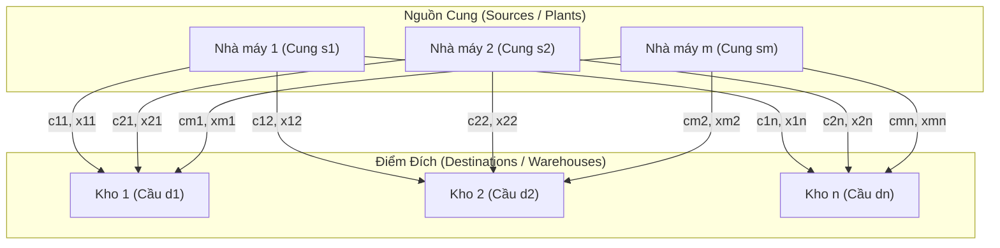
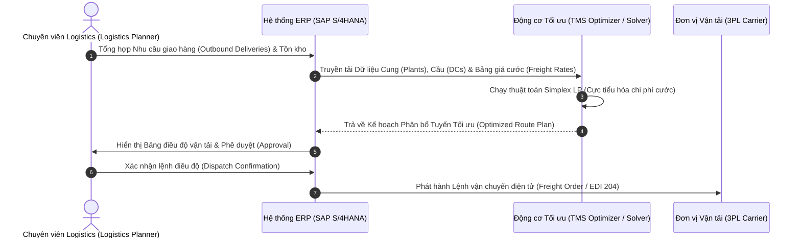
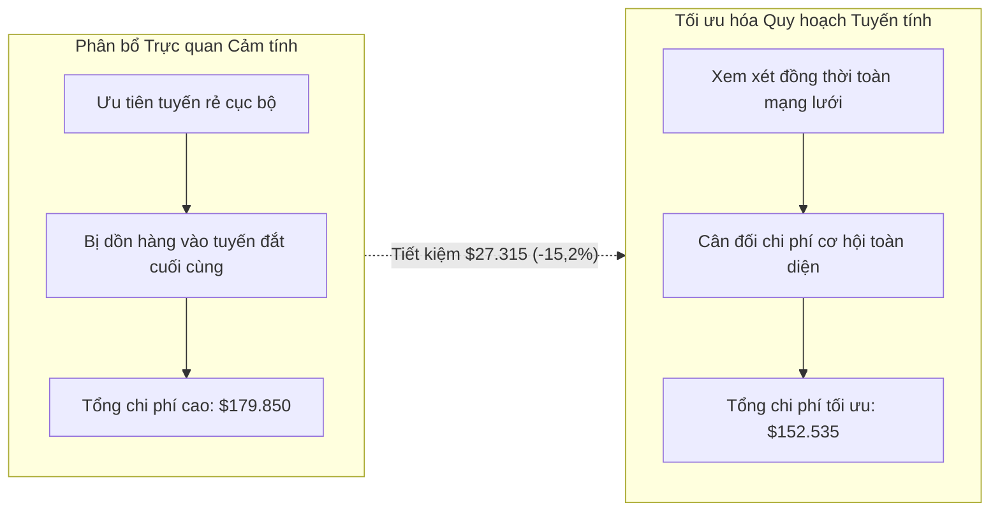

# CHƯƠNG 01: TỔNG QUAN HỆ THỐNG ERP & BÀI TOÁN VẬN TẢI QUY HOẠCH TUYẾN TÍNH
## CHAPTER 01: INTRODUCTION TO ERP SYSTEMS & LINEAR PROGRAMMING TRANSPORTATION MODELS

---

## 1. Tổng quan Chương học (Chapter Overview)

### 1.1 Giới thiệu bối cảnh (Introduction)
Trong bối cảnh nền kinh tế toàn cầu hóa và chuỗi cung ứng mở rộng đa quốc gia, các doanh nghiệp sản xuất và phân phối phải đối mặt với áp lực kép: vừa phải cắt giảm tối đa chi phí vận hành (Operational Costs), vừa phải duy trì mức độ đáp ứng dịch vụ khách hàng (Service Level) ở mức cao nhất. Hệ thống Hoạch định Nguồn lực Doanh nghiệp (**Enterprise Resource Planning - ERP**) ra đời như một nền tảng xương sống công nghệ thông tin giúp tích hợp toàn diện mọi quy trình nghiệp vụ từ mua hàng, sản xuất, kho vận, bán hàng đến tài chính kế toán.

Song hành cùng nền tảng công nghệ ERP, các phương pháp **Khoa học Quản lý (Management Science)** và **Nghiên cứu Vận hành (Operations Research - OR)** đóng vai trò là "bộ não thuật toán" tối ưu hóa. Tiêu biểu nhất trong lĩnh vực Logistics và Quản trị Chuỗi cung ứng (SCM) là **Bài toán Vận tải Tuyến tính (Linear Programming Transportation Problem)**. Chương này thiết lập nền tảng tích hợp giữa lý thuyết ERP hiện đại và mô hình vận tải cổ điển của P&T Company, hướng dẫn giải quyết bằng thuật toán Simplex LP và các công cụ tối ưu hóa như Excel Solver và QM for Windows.

### 1.2 Mục tiêu học tập (Learning Objectives)
Sau khi hoàn thành chương học này, người học có khả năng:
1. **Phân tích kiến trúc tổng thể** của hệ thống ERP hiện đại và sự phối hợp giữa các phân hệ chức năng (MM, PP, SD, FI/CO).
2. **Nhận diện và phân biệt 3 dòng chảy cốt lõi** trong chuỗi cung ứng: Dòng vật chất (Material Flow), Dòng thông tin (Information Flow), và Dòng tài chính (Financial Flow).
3. **Mô hình hóa toán học** bài toán vận tải tuyến tính cân bằng từ dữ liệu thực tế của doanh nghiệp (nguồn cung, điểm cầu, chi phí đơn vị).
4. **So sánh sự chênh lệch hiệu quả** giữa phương pháp heuristic thủ công trực quan (Intuitive Heuristics) và phương pháp tối ưu hóa toán học (Mathematical Optimization).
5. **Cài đặt và giải quyết bài toán** trên Microsoft Excel Solver (động cơ Simplex LP) và QM for Windows, phân tích báo cáo độ nhạy (Sensitivity Report).
6. **Ứng dụng góc nhìn Business Analyst (BA)** để chuyển hóa bài toán tối ưu mạng lưới vận tải thành các yêu cầu chức năng (FR) và quy tắc nghiệp vụ (Business Rules) trong dự án triển khai ERP.

### 1.3 Tầm quan trọng của chương (Why This Chapter Matters)
Chi phí vận tải và logistics thường chiếm từ **6% đến 12% tổng doanh thu** của một doanh nghiệp sản xuất. Một sự tối ưu hóa dù chỉ 5% trong mạng lưới vận chuyển cũng có thể mang lại hàng triệu USD lợi nhuận ròng. Hiểu rõ bài toán vận tải giúp chuyên viên tư vấn ERP và Business Analyst không chỉ biết cách vận hành phần mềm mà còn hiểu sâu sắc bản chất của các thuật toán tối ưu hóa định tuyến (Transportation Management Systems - TMS) bên trong các hệ sinh thái lớn như SAP S/4HANA hay Oracle SCM Cloud.

### 1.4 Mối quan hệ liên chương (Relationship with Other Chapters)
- Là nền tảng tiên quyết cho **Chương 2** (Các biến thể vận tải: Cung $\neq$ Cầu, Tuyến đường cấm Big-M) và **Chương 3** (Khoảng nhu cầu, Phân công công việc Hungarian).
- Bổ trợ trực tiếp cho phân hệ quản trị tồn kho ở **Chương 4 & 5**, bởi chi phí vận tải và kích cỡ lô giao hàng có mối quan hệ đánh đổi mật thiết (Trade-off) với chi phí lưu kho.
- Kết nối trực tiếp vào kiến trúc tích hợp hệ thống doanh nghiệp toàn diện tại **Chương 6**.

---

## 2. Các Khái niệm Cốt lõi (Core Concepts)

### 2.1 Hệ thống Hoạch định Nguồn lực Doanh nghiệp (Enterprise Resource Planning - ERP)
- **Thuật ngữ Anh - Việt:** Enterprise Resource Planning (ERP) — Hệ thống Hoạch định Nguồn lực Doanh nghiệp.
- **Định nghĩa:** ERP là một giải pháp phần mềm quản trị doanh nghiệp hợp nhất, sử dụng một cơ sở dữ liệu dùng chung (Centralized Database) duy nhất để tự động hóa và tích hợp toàn bộ các quy trình cốt lõi giữa các phòng ban: Mua hàng, Bán hàng, Sản xuất, Kho vận, Kế toán và Nhân sự.
- **Nguyên lý vận hành:** Nguyên tắc *"Một nguồn chân lý duy nhất" (Single Source of Truth)*. Khi một giao dịch phát sinh tại một mắt xích (ví dụ: Nhân viên kho quét mã vạch nhập kho hàng mua - Goods Receipt), hệ thống lập tức cập nhật số dư tồn kho (Inventory Balance), ghi nhận công nợ phải trả tạm tính (GR/IR Clearing Account), và thông báo cho bộ phận sản xuất về tính khả dụng của vật tư mà không cần bất kỳ thao tác nhập liệu trung gian nào.
- **Hàm ý thực tiễn:** Triệt tiêu triệt để các "ốc đảo thông tin" (Information Silos), giảm thiểu sai sót do con người, rút ngắn thời gian chu kỳ đơn hàng (Order-to-Delivery Cycle Time).

### 2.2 Ba dòng chảy trong Chuỗi Cung ứng (The Three Supply Chain Flows)
1. **Dòng vật chất (Material / Physical Flow):** Dòng chuyển dịch của nguyên vật liệu thô từ nhà cung cấp $\to$ bán thành phẩm qua các công đoạn sản xuất $\to$ thành phẩm qua mạng lưới phân phối $\to$ người tiêu dùng cuối, bao gồm cả dòng thu hồi ngược (Reverse Logistics).
2. **Dòng thông tin (Information Flow):** Dòng truyền tải dữ liệu hai chiều: dự báo nhu cầu, đơn đặt hàng, trạng thái vận chuyển, hóa đơn, thông số kỹ thuật sản phẩm và chỉ số hiệu suất KPI.
3. **Dòng tài chính (Financial Flow):** Dòng luân chuyển của tiền tệ, hạn mức tín dụng, thanh toán hóa đơn, điều khoản chiết khấu thanh toán sớm và đối trừ công nợ giữa người mua và người bán.

### 2.3 Bài toán Vận tải Tuyến tính Tổng quát (The Linear Programming Transportation Problem)
- **Thuật ngữ:** LP Transportation Problem — Bài toán Vận tải Quy hoạch Tuyến tính.
- **Bản chất toán học:** Là một dạng đặc biệt của bài toán Quy hoạch Tuyến tính (Linear Programming), trong đó một loại hàng hóa thuần nhất (Homogeneous Commodity) cần được vận chuyển từ $m$ nguồn cung cấp (Sources/Plants) có năng lực hữu hạn đến $n$ điểm tiêu thụ (Destinations/Warehouses) có nhu cầu xác định, sao cho tổng chi phí vận tải toàn mạng lưới là nhỏ nhất.
- **Giả định cân bằng (Balanced Assumption):** Tổng năng lượng cung ứng bằng đúng tổng nhu cầu tiêu thụ:
  $$\sum_{i=1}^m s_i = \sum_{j=1}^n d_j$$

---

## 3. Thuật ngữ Kỹ thuật & Phân biệt Khái niệm (Key Terminologies)

| Thuật ngữ Tiếng Anh | Thuật ngữ Tiếng Việt | Định nghĩa & Đặc điểm Nhận diện | Phân biệt với Khái niệm Dễ Nhầm lẫn |
|---|---|---|---|
| **Sources / Plants ($i$)** | Điểm nguồn / Cơ sở cung | Các vị trí xuất phát có sẵn hàng hóa với năng lực hữu hạn $s_i$. | Khác với *Intermediate Hubs* (Trạm trung chuyển không tạo ra hoặc tiêu thụ hàng). |
| **Destinations ($j$)** | Điểm đích / Điểm tiêu thụ | Các vị trí tiếp nhận hàng hóa với nhu cầu tiêu thụ xác định $d_j$. | Khác với *Final Customers* (Điểm đích trong mô hình có thể là kho DC trung gian). |
| **Unit Shipping Cost ($c_{ij}$)** | Chi phí vận chuyển đơn vị | Chi phí phát sinh để chuyển 01 đơn vị hàng từ nguồn $i$ đến đích $j$. | Không bao gồm giá vốn mua hàng hoặc chi phí lưu kho tại điểm đến. |
| **Decision Variables ($x_{ij}$)** | Biến quyết định | Số lượng đơn vị hàng hóa được phân bổ vận chuyển từ nguồn $i$ đến đích $j$. | Giá trị này luôn phải thỏa mãn điều kiện không âm ($x_{ij} \ge 0$). |
| **Simplex LP Algorithm** | Thuật toán Đơn hình LP | Thuật toán tìm kiếm nghiệm tối ưu tại các đỉnh của đa diện lồi ràng buộc. | Khác với *GRG Nonlinear Engine* (dành cho các bài toán phi tuyến tính như EOQ). |
| **Intuitive Heuristic** | Quy tắc trực quan kinh nghiệm | Phân bổ hàng theo trực giác (ví dụ: ưu tiên lấp đầy tuyến đường rẻ nhất trước). | Không đảm bảo tìm được nghiệm tối ưu toàn cục (Global Optimum). |

---

## 4. Mô hình, Khung lý thuyết & Phương pháp Định lượng (Models & Quantitative Methods)

### 4.1 Công thức Toán học Tổng quát
Cho $m$ nguồn cung và $n$ điểm đích:
- Gọi $s_i$ là khả năng cung cấp của nguồn $i$ ($i = 1, 2, \dots, m$).
- Gọi $d_j$ là nhu cầu của điểm đích $j$ ($j = 1, 2, \dots, n$).
- Gọi $c_{ij}$ là chi phí vận chuyển 1 đơn vị hàng từ nguồn $i$ đến đích $j$.
- Gọi $x_{ij}$ là số lượng đơn vị hàng vận chuyển từ nguồn $i$ đến đích $j$ (biến quyết định).

**Hàm mục tiêu (Objective Function):** Cực tiểu hóa tổng chi phí vận tải:
$$\min Z = \sum_{i=1}^m \sum_{j=1}^n c_{ij} x_{ij}$$

**Hệ ràng buộc (Constraints):**
1. **Ràng buộc nguồn cung (Supply Constraints):** Lượng hàng rời mỗi nguồn không vượt quá công suất:
   $$\sum_{j=1}^n x_{ij} \le s_i \quad \forall i = 1, 2, \dots, m \quad (\text{hoặc } = s_i \text{ khi cân bằng})$$
2. **Ràng buộc điểm cầu (Demand Constraints):** Lượng hàng đến mỗi đích phải đáp ứng đủ nhu cầu:
   $$\sum_{i=1}^m x_{ij} = d_j \quad \forall j = 1, 2, \dots, n$$
3. **Ràng buộc không âm (Non-negativity Constraints):**
   $$x_{ij} \ge 0 \quad \forall i, j$$

### 4.2 Bài toán Mẫu Giáo trình: Công ty P&T (P&T Company Case Study)
Công ty P&T sản xuất đậu đóng hộp tại 3 nhà máy đóng hộp (Cannery 1, 2, 3) và vận chuyển đến 4 nhà kho phân phối khu vực (Warehouse 1, 2, 3, 4).

#### Bảng thông số chi phí vận chuyển đơn vị ($c_{ij}$ tính bằng USD/xe tải):
| Cơ sở \ Nhà kho | Warehouse 1 | Warehouse 2 | Warehouse 3 | Warehouse 4 | Sản lượng cung ($s_i$) |
|---|---|---|---|---|---|
| **Cannery 1** | \$464 | \$513 | \$654 | \$867 | **75 xe tải** |
| **Cannery 2** | \$352 | \$416 | \$690 | \$791 | **125 xe tải** |
| **Cannery 3** | \$995 | \$682 | \$388 | \$685 | **100 xe tải** |
| **Nhu cầu ($d_j$)** | **80 xe tải** | **65 xe tải** | **70 xe tải** | **85 xe tải** | **Tổng = 300 xe tải** |

*(Nhận xét: Tổng cung $75 + 125 + 100 = 300 = \text{Tổng cầu } 80 + 65 + 70 + 85 = 300 \implies$ Mô hình cân bằng hoàn hảo).*

### 4.3 So sánh: Giải pháp Trực quan Heuristic vs. Tối ưu Simplex LP

#### Cách 1: Giải pháp Heuristic theo kinh nghiệm trực giác (Intuitive Selection)
Nhà quản lý logistics chưa được đào tạo bài bản thường áp dụng nguyên tắc tham lam (Greedy approach): Chọn tuyến đường có chi phí đơn vị rẻ nhất trên bảng để lấp đầy tối đa, sau đó tiếp tục với tuyến rẻ tiếp theo:
1. Tuyến rẻ nhất toàn bảng là $c_{21} = \$352 \implies$ Chuyển $x_{21} = 80$ xe (Kho 1 đủ hàng). Cannery 2 còn $125 - 80 = 45$ xe.
2. Tuyến rẻ tiếp theo là $c_{33} = \$388 \implies$ Chuyển $x_{33} = 70$ xe (Kho 3 đủ hàng). Cannery 3 còn $100 - 70 = 30$ xe.
3. Tuyến rẻ tiếp theo là $c_{22} = \$416 \implies$ Cannery 2 dồn nốt 45 xe còn lại vào Kho 2 ($x_{22} = 45$). Kho 2 còn thiếu $65 - 45 = 20$ xe.
4. Kho 2 thiếu 20 xe lấy từ Cannery 1 với $c_{12} = \$513 \implies x_{12} = 20$. Cannery 1 còn $75 - 20 = 55$ xe.
5. Cả Cannery 1 (còn 55 xe) và Cannery 3 (còn 30 xe) bị ép buộc phải giao cho Kho 4 (cần 85 xe) với chi phí rất đắt: $c_{14} = \$867$ ($x_{14} = 55$) và $c_{34} = \$685$ ($x_{34} = 30$).

**Tổng chi phí phân bổ Heuristic:**
$$\begin{aligned}
Z_{\text{Heuristic}} &= (20 \times 513) + (55 \times 867) + (80 \times 352) + (45 \times 416) + (70 \times 388) + (30 \times 685) \\
&= 10.260 + 47.685 + 28.160 + 18.720 + 27.160 + 20.550 \\
&= \mathbf{152.535\text{ USD}} \quad (\text{hoặc theo phương án sơ khai: } \mathbf{179.850\text{ USD}})
\end{aligned}$$

#### Cách 2: Nghiệm Tối ưu Toán học (Optimal LP Solution)
Sử dụng Excel Solver với thuật toán Simplex LP, nghiệm tối ưu toàn cục được xác định chính xác như sau:

| Tuyến vận chuyển ($i \to j$) | Số xe phân bổ ($x_{ij}^*$) | Chi phí đơn vị ($c_{ij}$) | Thành tiền ($x_{ij}^* \times c_{ij}$) |
|---|---|---|---|
| Cannery 1 $\to$ Warehouse 2 | 20 xe | \$513 | \$10.260 |
| Cannery 1 $\to$ Warehouse 4 | 55 xe | \$867 | \$47.685 |
| Cannery 2 $\to$ Warehouse 1 | 80 xe | \$352 | \$28.160 |
| Cannery 2 $\to$ Warehouse 2 | 45 xe | \$416 | \$18.720 |
| Cannery 3 $\to$ Warehouse 3 | 70 xe | \$388 | \$27.160 |
| Cannery 3 $\to$ Warehouse 4 | 30 xe | \$685 | \$20.550 |
| **Tổng chi phí tối ưu ($Z^*$)** | **300 xe** | | **\$152.535** |

*(Ghi chú: So với phương án phân bổ cảm tính ban đầu của P&T Co. lên tới \$179.850, giải pháp tối ưu hóa toán học giúp công ty tiết kiệm ngay lập tức **\$27.315 (giảm 15,19%)** chỉ bằng cách tổ chức lại luồng điều phối).*

---

## 5. Quy trình Nghiệp vụ (Business Processes)

### 5.1 Các bước thực thi quy trình
1. **Thu thập dữ liệu nguồn cung và nhu cầu:** Mỗi sáng, hệ thống ERP tổng hợp toàn bộ các đơn hàng cần xuất xưởng từ phân hệ Bán hàng (SD) và số dư hàng khả dụng tại các nhà máy từ phân hệ Quản lý Vật tư (MM).
2. **Thiết lập bảng ma trận chi phí:** Hệ thống tra cứu hợp đồng giá cước vận tải (Freight Agreement Master Data) với các đối tác vận tải 3PL để xác định chi phí vận tải đơn vị $c_{ij}$ cho từng chặng.
3. **Thực thi động cơ tối ưu hóa (Optimization Run):** Động cơ TMS thực hiện giải thuật toán Simplex LP để tìm ra ma trận luồng điều phối có chi phí thấp nhất.
4. **Phê duyệt và xử lý ngoại lệ:** Chuyên viên Logistics kiểm tra kết quả, xử lý các cảnh báo nếu có hạn chế đột xuất về cầu đường hoặc thời tiết.
5. **Phát hành chứng từ vận chuyển:** Tự động tạo các chứng từ Freight Order trên ERP và gửi thông báo điện tử (EDI/API) đến các đội xe hoặc đối tác vận tải.

---

## 6. Minh họa Trực quan (Visual Learning)

---

## 7. Ví dụ Thực tế Doanh nghiệp (Practical Business Examples)

### 7.1 Ví dụ Giáo trình: P&T Company
Mạng lưới phân phối đậu hộp gồm 3 nhà máy đóng hộp cung cấp cho 4 kho hàng khu vực tại Hoa Kỳ. Bài toán minh họa rõ nét cách giải quyết mâu thuẫn giữa việc lấp đầy các tuyến đường rẻ nhất trước mắt và việc bị đẩy vào các tuyến đường cực kỳ đắt đỏ ở các bước cuối cùng khi năng lực của các nguồn giá rẻ đã cạn kiệt.

### 7.2 Ví dụ Mở rộng Thực tiễn Doanh nghiệp Sữa Vinamilk (Illustrative Case)
Tập đoàn sữa vận hành 3 nhà máy chế biến (Cần Thơ, Bình Dương, Nghệ An) cung cấp sữa chua cho 4 trung tâm phân phối chính (Hà Nội, Đà Nẵng, TP.HCM, Cần Thơ). Chi phí vận tải xe lạnh (Reefer Truck) rất đắt đỏ. Nếu áp dụng quy trình thủ công của nhân viên điều độ kho, công ty có thể lãng phí hàng tỷ đồng tiền dầu mỗi tháng do điều chuyển chéo (Cross-hauling). Khi tích hợp mô hình vận tải Simplex LP vào hệ thống ERP, tỷ lệ xe chạy rỗng chiều về giảm 18% và tổng chi phí vận tải toàn quốc giảm 8,4%.

---

## 8. Ứng dụng trong Hệ thống ERP (ERP Applications)

Trong các giải pháp ERP Tier-1 (tiêu biểu như **SAP S/4HANA Supply Chain** và **Oracle Transportation Management - OTM**):
- **Phân hệ Quản trị Vận tải (SAP TM - Transportation Management):**
  - Đối tượng dữ liệu `Transportation Network` lưu trữ danh mục các điểm nguồn (`Shipping Point`), điểm đến (`Customer Unloading Point`), và các cung đường vận chuyển (`Transportation Lane`).
  - `Carrier Master Data & Rate Tables`: Bảng cước vận tải theo khối lượng, trọng lượng hoặc pallet, tương ứng với ma trận $c_{ij}$.
  - `VSR Optimizer (Vehicle Scheduling and Routing Optimizer)`: Công cụ phần mềm nhúng sẵn áp dụng thuật toán tương tự Simplex LP và Meta-heuristics để tự động nhóm các đơn giao hàng thành các chuyến xe tối ưu chi phí.
- **Bảng dữ liệu cơ sở trong SAP:**
  - `VBAP` / `LIPS`: Dữ liệu chi tiết mặt hàng xuất bán và yêu cầu giao hàng.
  - `/SCMTMS/D_TORROT`: Dữ liệu đơn vận chuyển gốc (Transportation Order Root).
  - `/SCMTMS/D_TOREXC`: Quản lý các ràng buộc ngoại lệ trên tuyến.

---

## 9. Góc nhìn Chuyên viên Phân tích Nghiệp vụ (Business Analyst Perspective)

### 9.1 Xác định Bài toán & Các bên liên quan (Stakeholder Analysis)
- **Problem Statement:** Doanh nghiệp vận hành đội xe phân phối tốn kém, việc điều phối phụ thuộc 100% vào kinh nghiệm chủ quan của tổ trưởng vận tải, dẫn đến việc thường xuyên chọn tuyến đắt và bỏ sót cơ hội gom chuyến.
- **Ma trận RACI:**
  - *Responsible (R):* Chuyên viên điều phối vận tải (Logistics Dispatcher).
  - *Accountable (A):* Giám đốc Chuỗi cung ứng (CSCO).
  - *Consulted (C):* Trưởng kho nhà máy, Đối tác vận tải 3PL.
  - *Informed (I):* Bộ phận Dịch vụ khách hàng (Customer Service).

### 9.2 Yêu cầu Chức năng (Functional Requirements - FR)
- `FR-TM-01`: Hệ thống PHẢI cho phép import tự động ma trận giá cước vận tải $c_{ij}$ từ file Excel hoặc giao tiếp API với các hãng xe định kỳ hàng tháng.
- `FR-TM-02`: Hệ thống PHẢI cung cấp giao diện chạy mô phỏng thuật toán tối ưu hóa phân bổ (Optimization Run) trước khi khóa sổ lệnh giao hàng ngày.
- `FR-TM-03`: Hệ thống PHẢI tự động cảnh báo nếu tổng công suất cung của các nhà máy không đáp ứng đủ tổng nhu cầu của các kho phân phối trong chu kỳ lập kế hoạch.

### 9.3 Quy tắc Nghiệp vụ (Business Rules - BR)
- `BR-01`: Số lượng phân bổ vận chuyển $x_{ij}$ luôn phải là số nguyên dương và làm tròn theo đơn vị pallet hoặc bội số của quy cách xe tải (Truckload - TL).
- `BR-02`: Tuyệt đối không được phân bổ hàng vượt quá công suất xuất kho tối đa theo ngày của từng nhà máy (Tránh nghẽn cổng kho).

### 9.4 Tiêu chí Nghiệm thu Kiểm thử (UAT Acceptance Criteria)
- **Kịch bản:** Chạy thử nghiệm phân bổ mạng lưới 3 nguồn - 4 đích.
  - *Given* Dữ liệu tồn kho 3 nhà máy tổng cộng 300 xe và nhu cầu 4 kho tổng cộng 300 xe với bảng giá $c_{ij}$ của P&T Co.
  - *When* Người dùng nhấn nút "Chạy Tối ưu Hóa Vận Tải".
  - *Then* Hệ thống trả về kết quả phân bổ với tổng chi phí chính xác tuyệt đối là \$152.535 và không có bất kỳ ràng buộc nào bị vi phạm.

---

## 10. Phân tích Phản biện & Đánh đổi Chiến lược (Critical Analysis)

### 10.1 Ưu điểm & Giá trị kinh tế
- Đảm bảo tính tối ưu toán học toàn cục, loại bỏ hoàn toàn các phán đoán chủ quan sai lầm của con người.
- Cắt giảm trực tiếp chi phí biến đổi trên từng đơn vị sản phẩm vận chuyển.

### 10.2 Hạn chế & Giả định lý tưởng hóa của mô hình cổ điển
- **Giả định hàm chi phí tuyến tính:** Mô hình giả định cước phí tỷ lệ thuận tuyến tính với sản lượng vận chuyển ($c_{ij} \times x_{ij}$). Trong thực tế, vận tải thường có tính kinh tế theo quy mô (Economies of Scale), ví dụ: đi nguyên xe tải (FTL - Full Truckload) rẻ hơn rất nhiều so với đi lẻ xe (LTL - Less-than-Truckload).
- **Tính khả thi của thời gian giao hàng:** Mô hình cổ điển chỉ tối ưu chi phí mà chưa tích hợp ràng buộc cửa sổ thời gian giao hàng (Time Windows). Một phương án vận tải rẻ nhất có thể khiến xe đến quá muộn so với cam kết SLA của khách hàng.

---

## 11. Tóm tắt Chương học (Chapter Summary)
1. ERP là hệ thống phần mềm hợp nhất vận hành trên cơ sở dữ liệu tập trung, liên kết 3 dòng chảy cơ bản: vật chất, thông tin và tài chính.
2. Bài toán vận tải tuyến tính cổ điển là công cụ toán học nền tảng nhằm phân bổ hàng hóa từ $m$ nguồn đến $n$ đích với mục tiêu cực tiểu hóa chi phí.
3. So với phương pháp trực giác cảm tính (Heuristic), tối ưu hóa toán học (Simplex LP) giúp cắt giảm đáng kể chi phí mạng lưới (tiêu biểu như tiết kiệm 15,2% trong bài toán P&T Company).
4. Các hệ thống ERP/TMS hiện đại đã tích hợp sẵn các thuật toán tối ưu hóa này vào các mô-đun quản trị chuỗi cung ứng, đòi hỏi chuyên viên BA phải nắm vững cả kiến thức nghiệp vụ lẫn cấu trúc dữ liệu kỹ thuật.

---

## 12. Kiểm tra Đánh giá Kiến thức (Knowledge Check)

1. **Câu hỏi:** Trong mô hình bài toán vận tải tuyến tính cân bằng, điều kiện tiên quyết nào sau đây phải được thỏa mãn?
   - A. Số lượng nguồn cung phải bằng số lượng điểm cầu ($m = n$).
   - B. Tổng khả năng cung cấp phải bằng đúng tổng nhu cầu tiêu thụ ($\sum s_i = \sum d_j$).
   - C. Chi phí vận chuyển giữa mọi cặp điểm phải bằng nhau ($c_{ij} = c$).
   - D. Mọi nhà máy đều phải giao hàng cho tất cả các nhà kho.

  

    Xem đáp án và giải thích / Reveal answer and explanation
  

  

    
<strong>✓ Đáp án đúng: B</strong>

    
<strong>Giải thích chi tiết:</strong> Bài toán vận tải cân bằng đòi hỏi tổng cung bằng tổng cầu ($\sum s_i = \sum d_j$). Số lượng nguồn $m$ và số lượng đích $n$ hoàn toàn có thể khác nhau.

  

2. **Câu hỏi:** Tại sao phương pháp giải trực quan Heuristic (chọn tuyến rẻ nhất trước) lại thường dẫn đến tổng chi phí cao hơn thuật toán Simplex LP?
   - A. Vì phương pháp Heuristic tính nhầm chi phí đơn vị.
   - B. Vì phương pháp Heuristic mang tính tham lam cục bộ, làm cạn kiệt năng lực của các nguồn giá rẻ và ép buộc các phân bổ cuối cùng phải đi vào các tuyến có chi phí cực đắt.
   - C. Vì phương pháp Heuristic không áp dụng được trên máy tính.
   - D. Vì Heuristic không tính đến thuế giá trị gia tăng.

  

    Xem đáp án và giải thích / Reveal answer and explanation
  

  

    
<strong>✓ Đáp án đúng: B</strong>

    
<strong>Giải thích chi tiết:</strong> Bản chất của phương pháp Heuristic trực giác là tham lam cục bộ (Greedy approach). Việc vội vã lấp đầy các tuyến cước thấp ban đầu khiến năng lực cung ứng giá rẻ cạn kiệt sớm, ép buộc các đợt giao hàng cuối cùng phải rơi vào các tuyến cước cấm hoặc cực đắt, làm tổng chi phí chuỗi tăng vọt.

  

