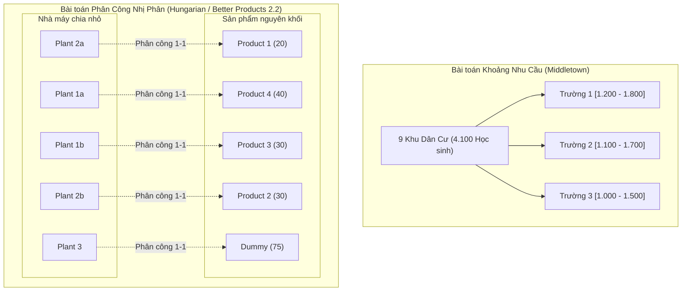
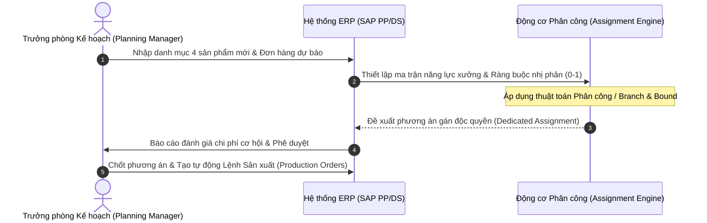
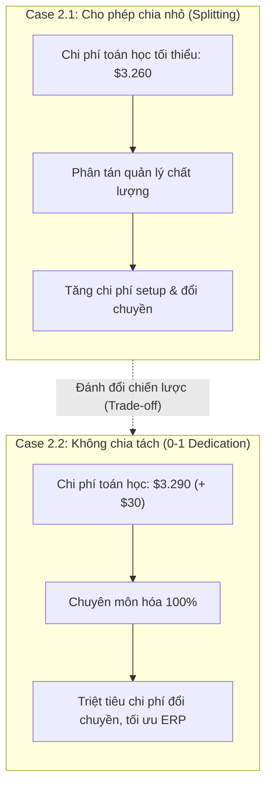

# CHƯƠNG 03: MỞ RỘNG MÔ HÌNH VẬN TẢI, KHOẢNG NHU CẦU & BÀI TOÁN PHÂN CÔNG
## CHAPTER 03: ADVANCED TRANSPORTATION EXTENSIONS, DEMAND RANGES & ASSIGNMENT MODELS

---

## 1. Tổng quan Chương học (Chapter Overview)

### 1.1 Giới thiệu bối cảnh (Introduction)
Trong điều kiện thực tế, các ràng buộc về nhu cầu khách hàng và khả năng tiếp nhận của các cơ sở hiếm khi là những con số cố định đơn lẻ. Nhu cầu có thể dao động trong một khoảng biến thiên $[\text{Nhu cầu tối thiểu}, \text{Nhu cầu tối đa}]$. Hơn nữa, mục tiêu của doanh nghiệp trong nhiều trường hợp không dừng lại ở việc cắt giảm chi phí vận tải thuần túy, mà hướng tới **Cực đại hóa Lợi nhuận gộp (Profit Maximization)** khi giá bán tại các thị trường và chi phí sản xuất tại các nhà máy có sự phân hóa rõ rệt.

Bên cạnh đó, trong nhiều quy trình sản xuất và phân bổ công việc, nhà quản lý không thể chia nhỏ nhiệm vụ (ví dụ: một sản phẩm phức tạp không nên bị xé lẻ sản xuất ở nhiều nhà xưởng khác nhau nhằm tránh chi phí thay đổi khuôn mẫu và phân tán chất lượng). Điều này dẫn tới sự chuyển đổi từ bài toán vận tải liên tục sang **Bài toán Phân công Nhị phân (0-1 Assignment Problem)**. Chương này nghiên cứu các kỹ thuật mở rộng: ràng buộc khoảng nhu cầu (**Middletown School District**), chuyển đổi cực đại hóa lợi nhuận (**Nifty Company**), thuật toán phân công **Hungarian Algorithm**, và bài toán phân công nguyên khối **Better Products Case 2.2**.

### 1.2 Mục tiêu học tập (Learning Objectives)
1. **Mô hình hóa các bài toán có khoảng nhu cầu biến thiên** (Demand Ranges $[L_j, U_j]$) bằng kỹ thuật tách ràng buộc kép.
2. **Nắm vững kỹ thuật chuyển đổi bài toán Cực đại hóa Lợi nhuận** thành bài toán Cực tiểu hóa Chi phí tương đương ($c_{ij} = P_{\max} - P_{ij}$).
3. **Phân tích bản chất của Bài toán Phân công 0-1** và giải bằng thuật toán Hungarian chuyên biệt hoặc Solver với ràng buộc nhị phân (Binary Constraints).
4. **Đánh giá sự đánh đổi kinh tế và vận hành** giữa phương án cho phép chia nhỏ sản phẩm (Case 2.1) và phương án phân công chuyên biệt nguyên khối (Case 2.2).
5. **Xây dựng tài liệu đặc tả BA** cho việc tích hợp thuật toán phân bổ chuyền sản xuất trên hệ thống ERP (SAP PP/APO).

### 1.3 Mối quan hệ liên chương (Relationship with Other Chapters)
- Hoàn thiện toàn bộ hệ thống lý thuyết về Tối ưu hóa Mạng lưới Vận tải & Phân bổ (Weeks 1 - 3).
- Là cầu nối tư duy sang quản trị quy mô lô sản xuất và chi phí thiết lập máy (Setup Cost) trong bài toán tồn kho ở **Chương 4 & 5**.

---

## 2. Các Khái niệm Cốt lõi (Core Concepts)

### 2.1 Khoảng Nhu cầu Tiếp nhận (Demand Ranges $[L_j, U_j]$)
Trong nhiều bối cảnh quy hoạch (như phân tuyến học sinh vào các trường học, hoặc phân phối hàng vào các kho có dung tích biến đổi), mỗi điểm đích $j$ có một ngưỡng tối thiểu bắt buộc phải nhận ($L_j$) và một ngưỡng tối đa có thể tiếp nhận ($U_j$):
$$L_j \le \sum_{i=1}^m x_{ij} \le U_j \quad \forall j$$
Kỹ thuật giải quyết: Tách mỗi điểm đích thành các biến phụ hoặc đưa trực tiếp 2 bất phương trình ràng buộc vào mô hình quy hoạch tuyến tính trên Solver.

### 2.2 Bài toán Cực đại hóa Lợi nhuận (Profit Maximization Transportation Model)
Khi mục tiêu là tối đa hóa lợi nhuận ròng:
$$\max Z = \sum_{i=1}^m \sum_{j=1}^n P_{ij} x_{ij}$$
Trong đó $P_{ij} = \text{Giá bán tại thị trường } j - \text{Chi phí sản xuất tại nhà máy } i - \text{Chi phí vận chuyển } (i \to j)$.
Để giải bằng các phần mềm hoặc thuật toán chỉ hỗ trợ cực tiểu hóa chi phí (Cost Minimization Engine), ta chuyển đổi ma trận lợi nhuận thành ma trận chi phí cơ hội bằng công thức:
$$c_{ij} = P_{\max} - P_{ij}$$
Trong đó $P_{\max}$ là giá trị lợi nhuận đơn vị lớn nhất trong toàn bộ ma trận. Việc cực tiểu hóa tổng giá trị $\sum (P_{\max} - P_{ij}) x_{ij}$ sẽ cho ra đúng nghiệm cực đại hóa của bài toán gốc.

### 2.3 Bài toán Phân công 0-1 (The Binary 0-1 Assignment Problem)
- **Định nghĩa:** Là dạng đặc biệt của bài toán vận tải, trong đó $n$ công việc cần được giao cho $n$ nhân sự hoặc máy móc thực hiện theo nguyên tắc **Một - Một (One-to-One)**: Mỗi nguồn chỉ được giao đúng một đích, và mỗi đích chỉ do đúng một nguồn đảm nhận.
- **Biến quyết định nhị phân:**
  $$x_{ij} \in \{0, 1\} \quad (x_{ij} = 1 \text{ nếu nguồn } i \text{ được giao việc } j; x_{ij} = 0 \text{ nếu không})$$
- **Ràng buộc chuẩn:** $\sum_{j=1}^n x_{ij} = 1 \ (\forall i)$ và $\sum_{i=1}^n x_{ij} = 1 \ (\forall j)$.

---

## 3. Thuật ngữ Kỹ thuật & Phân biệt Khái niệm (Key Terminologies)

| Thuật ngữ Tiếng Anh | Thuật ngữ Tiếng Việt | Định nghĩa & Ý nghĩa Phân tích |
|---|---|---|
| **Demand Range** | Khoảng nhu cầu biến thiên | Miền giá trị từ mức sàn tối thiểu đến mức trần tối đa của điểm tiếp nhận. |
| **Profit Contribution** | Mức đóng góp lợi nhuận | Lợi nhuận biên đơn vị thu được sau khi trừ chi phí sản xuất và vận tải. |
| **0-1 Assignment Model** | Mô hình phân công nhị phân | Mô hình tối ưu hóa với các biến nhận giá trị 0 hoặc 1 (nguyên khối). |
| **Hungarian Algorithm** | Thuật toán Hungari | Phương pháp tổ hợp giải bài toán phân công $n \times n$ dựa trên ma trận giảm (Reduced Matrix). |
| **Product Dedication** | Chuyên biệt hóa sản phẩm | Chính sách cố định 1 sản phẩm chỉ sản xuất tại 1 nhà xưởng duy nhất. |
| **Split Delivery Penalty** | Chi phí phạt do phân mảnh | Chi phí phát sinh do quản lý đơn hàng phân tán, đổi khuôn và nghiệm thu nhiều nơi. |

---

## 4. Mô hình, Khung lý thuyết & Phương pháp Định lượng (Models & Quantitative Methods)

### 4.1 Minh họa Giáo trình: Middletown School District
Hội đồng Giáo dục Middletown cần phân bổ 4.100 học sinh từ 9 khu dân cư vào 3 trường trung học cơ sở. Mỗi trường có quy mô tiếp nhận tối thiểu và tối đa:
- Trường 1: Sĩ số trong khoảng $[1.200; 1.800]$ học sinh.
- Trường 2: Sĩ số trong khoảng $[1.100; 1.700]$ học sinh.
- Trường 3: Sĩ số trong khoảng $[1.000; 1.500]$ học sinh.
Tổng sĩ số tối thiểu cần đáp ứng là $1.200 + 1.100 + 1.000 = 3.300 \le 4.100$, và tổng công suất tối đa là $1.800 + 1.700 + 1.500 = 5.000 \ge 4.100$. Mô hình được giải bằng Linear Programming trên Excel Solver với các ràng buộc bất phương trình kép, tìm ra phương án đưa đón bằng xe buýt có tổng số dặm học sinh di chuyển là nhỏ nhất.

### 4.2 Minh họa Giáo trình: Nifty Company (Cực đại hóa Lợi nhuận)
Công ty Nifty có 3 nhà máy sản xuất sản phẩm xuất khẩu sang 4 thị trường tiêu thụ. Do chênh lệch thuế quan và giá niêm yết bán lẻ:
- Khung nhu cầu của các khách hàng dao động từ mức tối thiểu 12.000 đơn vị đến tối đa 30.000 đơn vị.
- Lợi nhuận đơn vị $P_{ij}$ dao động từ $\$15$ đến $\$65$ mỗi đơn vị.
- $P_{\max} = \$65$.
- Bằng cách biến đổi chi phí tương đương $c_{ij} = 65 - P_{ij}$, bài toán được giải tối ưu bằng thuật toán Simplex LP, đem lại lợi nhuận cực đại cho Nifty Company.

### 4.3 Phân tích Chuyên sâu: Better Products Case 2.2 (Phân công Nguyên khối Không chia nhỏ)
Trong Case 2.2, ban giám đốc Better Products nhận thấy việc chia nhỏ sản phẩm (Case 2.1) gây xáo trộn tổ chức sản xuất. Công ty áp dụng quy tắc: **Mỗi sản phẩm mới chỉ được sản xuất độc quyền tại đúng một nhà máy duy nhất**.

Để đưa bài toán về mô hình phân công hoặc vận tải nguyên khối:
- Nhà máy 1 (Công suất 75) được tách thành 2 "nhà máy ảo": Nhà máy 1a và Nhà máy 1b.
- Nhà máy 2 (Công suất 75) được tách thành: Nhà máy 2a và Nhà máy 2b.
- Nhà máy 3 (Công suất 45) giữ nguyên.
- Mỗi đơn vị nhà máy ảo chỉ nhận tối đa 1 sản phẩm.

#### Bảng kết quả so sánh kinh tế giữa Case 2.1 và Case 2.2:
| Tiêu chí Đánh giá | Case 2.1: Cho phép chia nhỏ (Splitting) | Case 2.2: Không chia nhỏ (0-1 Dedicated) | Chênh lệch Vận hành |
|---|---|---|---|
| **Tổng chi phí biến đổi ($Z$)** | **\$3.260 / ngày** | **\$3.290 / ngày** | Tăng $+\$30/\text{ngày}$ ($+0,92\%$) |
| **Phân bổ cụ thể** | Plant 1 sản xuất SP 2 và SP 4 Plant 2 sản xuất SP 1 Plant 3 sản xuất SP 3 | Plant 1a $\to$ SP 4 ($40$ sp) Plant 1b $\to$ SP 3 ($30$ sp) Plant 2a $\to$ SP 1 ($20$ sp) Plant 2b $\to$ SP 2 ($30$ sp) | Mỗi sản phẩm quy về một mối quản lý |
| **Chi phí chuyển đổi khuôn (Changeover)** | Cao (do nhiều xưởng cùng chạy chung mẫu) | **Thấp nhất** (Chuyên môn hóa chuyền) | Tiết kiệm thời gian setup |
| **Rủi ro kiểm soát chất lượng** | Khó đồng nhất chất lượng giữa các xưởng | **Đồng nhất 100%** | Giảm tỷ lệ hàng lỗi |

  

    💡
    <strong>Góc nhìn Business Analyst — Đánh đổi giữa chi phí trực tiếp và chi phí vận hành</strong>
  

  
Mặc dù phương án Case 2.2 có chi phí trực tiếp cao hơn Case 2.1 là 30 USD/ngày, phương án này vẫn có thể mang lại hiệu quả kinh tế tốt hơn nếu giúp doanh nghiệp tiết kiệm chi phí đổi khuôn, thời gian thiết lập máy và chi phí quản lý vận hành.

  
Tuy nhiên, không thể kết luận Case 2.2 luôn tốt hơn trong mọi trường hợp. Business Analyst cần định lượng tổng chi phí của cả hai phương án, bao gồm chi phí sản xuất trực tiếp, chi phí setup, chi phí quản lý và các chi phí liên quan khác, trước khi đưa ra khuyến nghị.

  
  

  
  

    <strong>Business Analyst Insight — Trade-off Between Direct and Operational Costs</strong>
  

  
Although Case 2.2 has a direct cost that is USD 30/day higher than Case 2.1, it may still be economically preferable if it reduces machine setup costs, setup time, and operational management expenses.

  
However, Case 2.2 should not automatically be considered superior in every situation. A Business Analyst should quantify the total cost of both alternatives, including direct production costs, setup costs, management expenses, and other relevant operational costs before making a recommendation.

---

## 5. Quy trình Nghiệp vụ (Business Processes)

---

## 6. Minh họa Trực quan (Visual Learning)

---

## 7. Ví dụ Thực tế Doanh nghiệp (Practical Business Examples)

### 7.1 Ví dụ Doanh nghiệp Dệt may May 10 (Illustrative Enterprise Example)
Tổng công ty May 10 nhận 4 đơn hàng gia công áo sơ mi xuất khẩu sang Mỹ, EU, Nhật Bản và Hàn Quốc. Do tiêu chuẩn kỹ thuật (đường may, chất liệu chỉ) của mỗi thị trường khác nhau hoàn toàn, nếu chia nhỏ một đơn hàng may áo đi Mỹ sang 2 nhà xưởng ở Thái Bình và Hải Phòng sẽ gây rủi ro lệch màu vải và sai lệch form dáng. Bằng cách áp dụng mô hình phân công nhị phân tương tự Case 2.2, toàn bộ đơn hàng Mỹ được cố định giao cho xưởng Hải Phòng. Mặc dù chi phí vận chuyển nội địa tăng nhẹ 1,2%, nhưng tỷ lệ hàng đạt tiêu chuẩn xuất xưởng tăng từ 94% lên 99,6%.

---

## 8. Ứng dụng trong Hệ thống ERP (ERP Applications)

- **Mô-đun SAP PP/DS (Production Planning and Detailed Scheduling):**
  - Khái niệm `Production Version` (Phiên bản sản xuất): Định nghĩa mối quan hệ cố định giữa một mã vật tư (Material Code), một định mức nguyên liệu (BOM) và một dây chuyền xưởng cụ thể (Routing/Work Center).
  - Thuật toán `Detailed Scheduling Heuristics`: Cung cấp tùy chọn lập lịch ngăn chặn việc xé nhỏ lệnh sản xuất (`Prevent Order Splitting`) tương đương với ràng buộc nhị phân trong Case 2.2.
- **Bảng dữ liệu cốt lõi trong SAP:**
  - `PLKO` / `PLPO`: Dữ liệu định tuyến công đoạn nhà xưởng (Routing Header & Operation).
  - `AFKO` / `AFPO`: Dữ liệu chi tiết lệnh sản xuất đã phân bổ (Production Order Header & Item).

---

## 9. Góc nhìn Chuyên viên Phân tích Nghiệp vụ (Business Analyst Perspective)

### 9.1 Yêu cầu Chức năng (Functional Requirements - FR)
- `FR-ASN-01`: Hệ thống PHẢI cung cấp cờ cấu hình `Enforce Dedicated Line (No-Splitting)` trên giao diện lập kế hoạch sản xuất để người dùng có thể kích hoạt chế độ phân công nguyên khối.
- `FR-ASN-02`: Đối với các bài toán tối ưu hóa theo khoảng nhu cầu, hệ thống PHẢI kiểm tra tính khả thi trước khi giải: Tổng sàn nhu cầu $\sum L_j \le \text{Tổng cung} \le \text{Tổng trần nhu cầu} \sum U_j$.

### 9.2 Quy tắc Nghiệp vụ (Business Rules - BR)
- `BR-ASN-01`: Một lệnh sản xuất sau khi đã phân bổ vào xưởng chuyên biệt theo mô hình 0-1 không được phép tự động chia tách (Auto-split) khi điều độ lại trừ khi có phê duyệt ghi đè từ Giám đốc Sản xuất.
- `BR-ASN-02`: Trong bài toán cực đại hóa lợi nhuận, nếu lợi nhuận biên $P_{ij} \le 0$, hệ thống tự động loại bỏ biến phân bổ đó để tránh bán lỗ.

### 9.3 Tiêu chí Nghiệm thu (UAT Acceptance Criteria)
- **Kịch bản:** Kiểm thử phân công nguyên khối Case 2.2.
  - *Given* Cấu hình 4 sản phẩm và 3 nhà máy với tham số Better Products.
  - *When* Kích hoạt cờ `Prevent Order Splitting = True` và bấm tối ưu.
  - *Then* Hệ thống trả về kết quả 4 sản phẩm được gán nguyên vẹn vào các nhà xưởng với tổng chi phí đúng \$3.290/ngày; không có sản phẩm nào bị chia nhỏ sang 2 nhà máy.

---

## 10. Phân tích Phản biện & Đánh đổi Chiến lược (Critical Analysis)

- **Chi phí toán học vs. Chi phí vận hành thực tế:** Bài toán vận tải lý thuyết luôn tìm cách chia nhỏ số lượng đến từng đơn vị lẻ để đạt chi phí toán học thấp nhất ($3.260 vs $3.290). Tuy nhiên, trong quản trị hiện đại, chi phí điều hành, chi phí chuyển đổi máy (Changeover Downtime) và chi phí kiểm soát chất lượng mới là những yếu tố quyết định sự sống còn của doanh nghiệp.
- **Độ phức tạp tính toán (Computational Complexity):** Bài toán phân công nguyên khối là bài toán Quy hoạch Số nguyên (Integer Programming / NP-Hard). Khi quy mô tăng lên hàng trăm sản phẩm và hàng chục nhà máy, thời gian giải chính xác bằng phương pháp nhánh cận (Branch and Bound) có thể tăng theo cấp số nhân, đòi hỏi phải sử dụng các thuật toán Meta-heuristics (Genetic Algorithm, Simulated Annealing) trong thực tế ERP.

---

## 11. Tóm tắt Chương học (Chapter Summary)
1. Ràng buộc khoảng nhu cầu $[L_j, U_j]$ phản ánh chính xác tính linh hoạt của thị trường và sức chứa kho bãi thực tế.
2. Bài toán cực đại hóa lợi nhuận có thể chuyển đổi tương đương về bài toán cực tiểu hóa chi phí qua công thức $c_{ij} = P_{\max} - P_{ij}$.
3. Bài toán phân công 0-1 và quy tắc không chia nhỏ sản phẩm (Case 2.2) dù làm tăng nhẹ chi phí trực tiếp nhưng mang lại sự ổn định vượt trội cho vận hành nhà máy và quản lý ERP.
4. Business Analyst cần hiểu rõ sự đánh đổi giữa mức tối ưu toán học thuần túy và tính khả thi trong thực tiễn vận hành doanh nghiệp.

---

## 12. Kiểm tra Đánh giá Kiến thức (Knowledge Check)

1. **Câu hỏi:** Để chuyển đổi bài toán vận tải cực đại hóa lợi nhuận $\max \sum P_{ij} x_{ij}$ thành bài toán cực tiểu hóa chi phí giải được trên các thuật toán thông thường, ta sử dụng phép biến đổi nào?
   - A. $c_{ij} = -P_{ij}$
   - B. $c_{ij} = P_{\max} - P_{ij}$ (trong đó $P_{\max}$ là lợi nhuận đơn vị lớn nhất trong ma trận)
   - C. $c_{ij} = 1 / P_{ij}$
   - D. $c_{ij} = P_{ij} \times 100$

  

    Xem đáp án và giải thích / Reveal answer and explanation
  

  

    
<strong>✓ Đáp án đúng: B</strong>

    
<strong>Giải thích chi tiết:</strong> Để biến đổi bài toán cực đại hóa lợi nhuận sang cực tiểu hóa chi phí mà vẫn giữ mọi hệ số chi phí không âm ($c_{ij} \ge 0$), ta áp dụng phép tịnh tiến đối ngẫu: $c_{ij} = P_{\max} - P_{ij}$. Khi đó, tối thiểu hóa tổn thất cơ hội chính là tối đa hóa tổng lợi nhuận thu về.

  

2. **Câu hỏi:** Tại sao trong Case 2.2 (Better Products), ban lãnh đạo công ty lại chấp nhận mức chi phí $3.290/ngày (cao hơn $30/ngày so với mức $3.260/ngày của Case 2.1)?
   - A. Do tính nhầm số liệu chi phí.
   - B. Vì chính sách không chia nhỏ sản phẩm giúp chuyên môn hóa dây chuyền, loại bỏ chi phí đổi khuôn (setup cost) và giảm gánh nặng giám sát quản trị vận hành vượt xa khoản chênh lệch $30/ngày.
   - C. Vì luật pháp quy định mỗi nhà máy chỉ được sản xuất 1 sản phẩm.
   - D. Vì công đoàn từ chối sản xuất chia nhỏ.

  

    Xem đáp án và giải thích / Reveal answer and explanation
  

  

    
<strong>✓ Đáp án đúng: B</strong>

    
<strong>Giải thích chi tiết:</strong> Mặc dù Case 2.2 có chi phí trực tiếp cao hơn 30 USD/ngày ($30/day), nhưng trên thực tế phân xưởng, việc không chia nhỏ sản phẩm giúp mỗi nhà máy tập trung chuyên môn hóa một dòng sản phẩm duy nhất. Nhờ đó công ty tiết kiệm đáng kể thời gian dừng máy thay đổi khuôn mẫu (changeover time) và giảm thiểu rủi ro lẫn lộn chất lượng.

  

