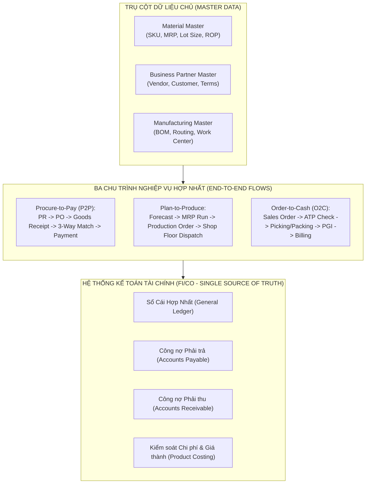
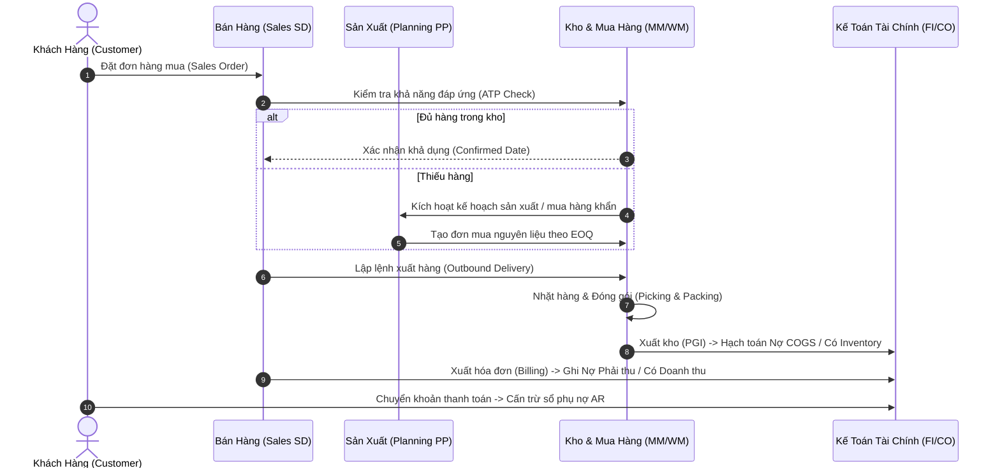
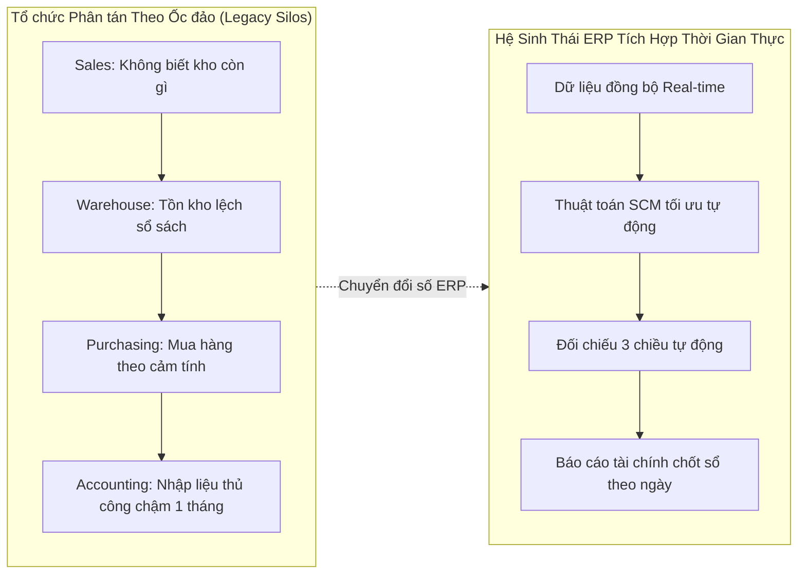

# CHƯƠNG 06: TÍCH HỢP QUY TRÌNH DOANH NGHIỆP & VẬN HÀNH CHUỖI CUNG ỨNG TOÀN DIỆN
## CHAPTER 06: ENTERPRISE PROCESS INTEGRATION & CROSS-FUNCTIONAL SCM ORCHESTRATION

---

## 1. Tổng quan Chương học (Chapter Overview)

### 1.1 Giới thiệu bối cảnh (Introduction)
Trong 5 chương trước, chúng ta đã tiếp cận các mô hình toán học và kỹ thuật tối ưu hóa chuyên sâu: từ bài toán định tuyến và phân bổ vận tải tuyến tính (Chương 1, 2, 3) đến các phương pháp quản trị quy mô lô và tồn kho khoa học (Chương 4, 5). Tuy nhiên, trong môi trường doanh nghiệp thực tế, không có một mắt xích hoặc thuật toán tối ưu nào có thể hoạt động một cách biệt lập (Isolated Silo). Một quyết định đặt hàng mua theo EOQ trong phân hệ Mua hàng (MM) sẽ lập tức tác động đến dòng tiền của phân hệ Kế toán (FI), mặt bằng diện tích của phân hệ Quản lý Kho (EWM), kế hoạch tiếp nhận của phân hệ Vận tải (TM), và lịch trình chạy máy của phân hệ Sản xuất (PP).

Chương 6 là chương tổng hợp và tích hợp toàn diện (**Capstone Synthesis Module**). Chương học này xâu chuỗi toàn bộ các kiến thức định lượng vào cấu trúc kiến trúc hệ sinh thái ERP tiêu chuẩn (như SAP S/4HANA hoặc Oracle Cloud ERP). Chúng ta sẽ mổ xẻ 3 chu trình nghiệp vụ khép kín xuyên suốt doanh nghiệp: **Order-to-Cash (O2C)**, **Procure-to-Pay (P2P)**, và **Plan-to-Produce (P2P/P2D)**, phân tích vai trò tối thượng của Dữ liệu Chủ (**Master Data Governance**) và định hình phương pháp luận cho một **Senior Business Analyst (BA)** khi dẫn dắt các dự án chuyển đổi số chuỗi cung ứng.

### 1.2 Mục tiêu học tập (Learning Objectives)
1. **Phân tích cơ chế tích hợp thời gian thực (Real-time Integration)** giữa các phân hệ chức năng cốt lõi: MM, PP, SD, FI, CO, TM và EWM.
2. **Làm chủ 3 trụ cột Dữ liệu Chủ (Master Data Governance)**: Material Master, Business Partner (Vendor/Customer), và BOM/Routing/Work Center.
3. **Mô hình hóa chi tiết dòng chảy chứng từ và giao dịch** trong 3 chu trình nghiệp vụ khép kín: Order-to-Cash (O2C), Procure-to-Pay (P2P), và Plan-to-Produce.
4. **Nhận diện cơ chế đối chiếu tự động 3 chiều (3-Way Matching)** và quản lý sai số hạn mức (Tolerance Limits) trong phân hệ Kế toán/Mua hàng.
5. **Xây dựng khung năng lực và kế hoạch hành động toàn diện cho Business Analyst**: Từ việc khơi gợi yêu cầu, xây dựng tài liệu BRD/FRD, thiết kế quy tắc nghiệp vụ đến tổ chức kiểm thử người dùng (UAT) và quản trị chuyển đổi (Change Management).

### 1.3 Mối quan hệ liên chương (Relationship with Other Chapters)
- Là đỉnh cao tổng hợp tích hợp toàn bộ kiến thức của **Chương 1 đến Chương 5**.
- Chuyển hóa các bài toán Case Study rời rạc (Texago, Better Products, ACT, SOCA) thành các tham số cấu hình sống động trong cơ sở dữ liệu hệ thống ERP doanh nghiệp.

---

## 2. Các Khái niệm Cốt lõi (Core Concepts)

### 2.1 Bản chất của Tích hợp Quy trình Xuyên chức năng (Cross-Functional Integration)
Tích hợp trong ERP không đơn thuần là việc kết nối mạng máy tính hay trao đổi file dữ liệu, mà là sự **đồng bộ hóa trạng thái nghiệp vụ và dữ liệu tài chính theo thời gian thực (Real-time Event-Driven Synchronization)**. Một sự kiện nghiệp vụ vật lý (ví dụ: Nhân viên kho quét mã vạch xuất kho 100 chiếc lốp xe giao cho khách hàng) sẽ kích hoạt đồng thời 4 hiệu ứng tự động trên toàn hệ thống:
1. **Phân hệ Kho (EWM):** Giảm số lượng tồn kho vật lý tại Bin lưu trữ cụ thể.
2. **Phân hệ Quản trị Vật tư (MM):** Giảm giá trị tồn kho trên sổ phụ kho và cập nhật số dư khả dụng.
3. **Phân hệ Bán hàng (SD):** Cập nhật trạng thái chứng từ Giao hàng (Outbound Delivery) thành "Đã xuất hàng hoàn tất" (Completely Processed).
4. **Phân hệ Kế toán Tài chính (FI):** Tự động sinh chứng từ kế toán ghi nợ tài khoản Giá vốn hàng bán (COGS - Debit) và ghi có tài khoản Tồn kho hàng hóa (Inventory - Credit) mà không cần kế toán viên phải hạch toán thủ công.

### 2.2 Ba Trụ cột Dữ liệu Chủ Doanh nghiệp (Enterprise Master Data Pillars)
Dữ liệu chủ là tài sản thông tin cốt lõi, tồn tại lâu dài và được chia sẻ xuyên suốt mọi giao dịch của doanh nghiệp:
1. **Material Master (Dữ liệu Chủ Vật tư):** Trung tâm của mọi luồng vật chất, được phân cấp theo các góc nhìn chuyên môn (Views):
   - *Basic Data View:* Mã SKU, tên vật tư, đơn vị tính cơ sở, quy cách đóng gói.
   - *Purchasing View:* Nhóm mua hàng, thời gian Lead Time của nhà cung cấp.
   - *MRP 1, 2, 3, 4 Views:* Loại hoạch định (MRP Type), chính sách định cỡ lô (Lot Size: Fixed, EOQ, Period), điểm đặt hàng lại (ROP), tồn kho an toàn (Safety Stock).
   - *Plant Data / Storage View:* Vị trí lưu kho, điều kiện bảo quản nhiệt độ/độ ẩm.
   - *Accounting & Costing Views:* Phương pháp tính giá xuất kho (Standard Cost hoặc Moving Average), phân nhóm tài khoản kế toán (Valuation Class).
2. **Business Partner Master (Dữ liệu Chủ Đối tác Kinh doanh):** Quản lý tập trung thông tin Nhà cung cấp (Vendor) và Khách hàng (Customer):
   - Mã định danh đối tác, địa chỉ giao hàng, điều khoản thanh toán (Payment Terms: Net 30, 2/10 Net 30), điều kiện giao hàng Incoterms, hạn mức tín dụng (Credit Limit).
3. **Manufacturing Master Data (Dữ liệu Chủ Sản xuất):**
   - *Bill of Materials (BOM):* Cây định mức cấu thành sản phẩm (công thức nguyên vật liệu).
   - *Work Center Master:* Trung tâm máy móc thiết bị, năng suất danh định ($p$), chi phí vận hành máy và chi phí nhân công theo giờ.
   - *Routing Master:* Trình tự các công đoạn gia công và thời gian thiết lập máy ($K$).

---

## 3. Thuật ngữ Kỹ thuật & Phân biệt Khái niệm (Key Terminologies)

| Thuật ngữ Tiếng Anh | Thuật ngữ Tiếng Việt | Định nghĩa & Ý nghĩa Nghiệp vụ |
|---|---|---|
| **Order-to-Cash (O2C)** | Chu trình từ Đơn hàng đến Thu tiền | Quy trình khép kín từ lúc nhận đơn đặt hàng của khách $\to$ giao hàng $\to$ xuất hóa đơn $\to$ thu tiền cước. |
| **Procure-to-Pay (P2P)** | Chu trình từ Mua sắm đến Chi trả | Quy trình từ lúc phát sinh nhu cầu mua vật tư $\to$ phát hành PO $\to$ nhập kho hàng $\to$ thanh toán cho NCC. |
| **Plan-to-Produce (P2P / P2D)** | Chu trình từ Kế hoạch đến Sản xuất | Quy trình từ dự báo nhu cầu $\to$ chạy thuật toán MRP $\to$ phát hành Lệnh sản xuất $\to$ nhập kho thành phẩm. |
| **3-Way Matching** | Đối chiếu tự động 3 chiều | Kiểm tra sự khớp nhau giữa 3 chứng từ: Purchase Order, Goods Receipt Note và Hóa đơn Supplier Invoice. |
| **Tolerance Limits** | Ngưỡng sai số cho phép | Giới hạn dung sai (về giá hoặc số lượng) mà hệ thống tự động chấp nhận thanh toán mà không cần duyệt lại. |
| **Goods Receipt / Issue (GR/GI)** | Nhập kho / Xuất kho hàng | Các nghiệp vụ làm tăng hoặc giảm số lượng vật lý và giá trị tài chính của tồn kho trên hệ thống. |

---

## 4. Mô hình, Khung lý thuyết & Phương pháp Định lượng (Models & Quantitative Methods)

### 4.1 Chu trình 1: Procure-to-Pay (P2P) và Cơ chế Đối chiếu 3 Chiều
Chu trình P2P chịu sự chi phối trực tiếp của mô hình tồn kho EOQ (Chương 4 & 5):
1. **Purchase Requisition (PR):** Tự động sinh ra khi MRP quét thấy tồn kho rơi xuống dưới điểm đặt hàng lại $\text{ROP} = 180$. Số lượng đặt mua mặc định lấy theo $Q^* = 573$.
2. **Purchase Order (PO):** Bộ phận mua hàng xác nhận nhà cung cấp và giá mua $c = \$20$ kèm các điều kiện chiết khấu.
3. **Goods Receipt (GR):** Thủ kho tiếp nhận hàng tại cửa kho, hệ thống ghi nhận tăng kho (Mvt Type 101) và tự động hạch toán tài khoản trung gian:
   - *Ghi Nợ (Debit):* Tài khoản Tồn kho lốp xe (Inventory): $573 \times \$20 = \$11.460$.
   - *Ghi Có (Credit):* Tài khoản Tạm tính Phải trả người bán (GR/IR Clearing Account): $\$11.460$.
4. **Invoice Verification (3-Way Matching):** Khi hóa đơn của nhà cung ứng gửi đến, hệ thống ERP tự động đối chiếu chéo 3 tiêu chí:
   - Số lượng trên Hóa đơn $\le$ Số lượng thực tế đã Nhập kho trên GR Note.
   - Đơn giá trên Hóa đơn $=$ Đơn giá đã cam kết trên Purchase Order.
   - Các khoản thuế và cước phí vận tải khớp với điều khoản Incoterms đã quy định.
   Nếu khớp trong giới hạn sai số (Tolerance Limit, ví dụ $\pm 1\%$), hệ thống tất toán tài khoản GR/IR và ghi nhận công nợ chính thức vào Sổ phụ Phải trả (AP).

---

### 4.2 Chu trình 2: Order-to-Cash (O2C) và Tích hợp Tối ưu Vận tải
Chu trình O2C kết nối trực tiếp với bài toán vận tải tuyến tính (Chương 1, 2, 3):
1. **Sales Order Creation:** Nhân viên kinh doanh nhập đơn hàng của khách hàng.
2. **Available-to-Promise (ATP Check):** Hệ thống quét tồn kho tại các nhà máy và kho trung tâm theo thời gian thực để xác nhận ngày có thể giao hàng.
3. **Transportation Optimization (TMS):** Động cơ TMS gom các đơn hàng xuất bán và áp dụng thuật toán Simplex LP để điều chuyển xe từ các nhà máy tối ưu chi phí (như mô hình P&T Company).
4. **Outbound Delivery & Post Goods Issue (PGI):** Xuất hàng rời kho, tự động ghi nhận giá vốn hàng bán (COGS).
5. **Customer Billing & Cash Application:** Xuất hóa đơn tài chính điện tử và cấn trừ công nợ khi nhận được tiền thanh toán qua ngân hàng.

---

### 4.3 Chu trình 3: Plan-to-Produce và Vòng lặp MRP Khép kín
Chu trình sản xuất hiện thực hóa mô hình bổ sung dần EPQ (Chương 5):
1. **Master Production Schedule (MPS):** Thiết lập lịch trình sản xuất tổng thể cho thành phẩm.
2. **Material Requirements Planning (MRP Run):** Động cơ tính toán "nổ" định mức BOM, tính toán nhu cầu ròng nguyên vật liệu và áp dụng quy tắc định cỡ lô EPQ (như lô 50.000 loa của SOCA).
3. **Production Order Execution:** Phát hành lệnh sản xuất xuống phân xưởng, ghi nhận thời gian chạy máy danh định $t_p$ và chi phí thiết lập khuôn máy $K$.
4. **Order Settlement:** Kết chuyển chi phí nhân công, điện nước và khấu hao thực tế vào giá thành sản phẩm hoàn thành nhập kho.

---

## 5. Quy trình Nghiệp vụ (Business Processes)

---

## 6. Minh họa Trực quan (Visual Learning)

---

## 7. Ví dụ Thực tế Doanh nghiệp (Practical Business Examples)

### 7.1 Tình huống Tích hợp Doanh nghiệp: Tập đoàn Sữa TH True Milk
TH True Milk vận hành một chuỗi cung ứng khép kín từ đồng cỏ bò sữa tại Nghệ An đến nhà máy chế biến và hệ thống phân phối bán lẻ TH True Mart toàn quốc. Trước khi triển khai ERP, thông tin đàn bò và sản lượng sữa tươi vắt hàng ngày được ghi chép trên các file Excel rời rạc. Khi tích hợp hệ sinh thái ERP SAP S/4HANA:
- Dòng sữa nguyên liệu sau khi làm lạnh được ghi nhận ngay vào phân hệ MM.
- Thuật toán MPS/PP tự động tính toán nhu cầu phụ liệu (đường, hương liệu, bao bì Tetra Pak) theo kích cỡ lô kinh tế EOQ.
- Lịch trình xe bồn lạnh vận chuyển sữa về các tổng kho được giải tối ưu bằng phân hệ SAP TM tương tự mô hình vận tải Simplex LP.
Kết quả: Tỷ lệ thất thoát nguyên liệu sữa giảm 14%, thời gian chốt sổ tài chính cuối tháng rút ngắn từ 12 ngày xuống còn đúng 2 ngày.

---

## 8. Ứng dụng trong Hệ thống ERP (ERP Applications)

- **Cấu hình Quy tắc Tích hợp Bút toán Tự động (Automatic Account Determination):**
  - Giao dịch `OBYC` trong SAP: Đây là "trái tim" kết nối giữa phân hệ Logistics và phân hệ Kế toán. Tại đây, chuyên viên ERP cài đặt các khóa giao dịch (`Transaction Keys`):
    - `BSX`: Xác định tài khoản sổ cái hạch toán Tồn kho (Inventory Postings).
    - `WRX`: Xác định tài khoản Tạm tính Phải trả người bán (GR/IR Clearing Account).
    - `PRD`: Xác định tài khoản Chênh lệch giá mua (Price Difference Account) khi giá trên hóa đơn khác giá trên PO vượt ngưỡng dung sai.
- **Quản lý Tính toàn vẹn Dữ liệu Chủ (Data Governance):**
  - Sử dụng công cụ `SAP Master Data Governance (MDG)` để kiểm soát quy trình phê duyệt đa cấp (Approval Workflow) khi tạo mới một mã vật tư hoặc thay đổi điểm đặt hàng lại ROP, đảm bảo không một phòng ban nào có thể tự ý sửa đổi tham số mà không có sự đồng thuận liên chức năng.

---

## 9. Góc nhìn Chuyên viên Phân tích Nghiệp vụ (Business Analyst Perspective)

### 9.1 Vai trò Trọng tâm của Business Analyst trong Dự án ERP
Business Analyst là "cầu nối phiên dịch" giữa các yêu cầu ngôn ngữ nghiệp vụ của người dùng cuối và cấu trúc dữ liệu kỹ thuật của phần mềm ERP. Trách nhiệm của BA bao gồm:
1. **Khảo sát Hiện trạng (As-Is Process Mapping):** Vẽ lại chân thực các luồng công việc thủ công hiện tại, chỉ ra các nút thắt cổ chai và lãng phí thời gian.
2. **Thiết kế Tương lai (To-Be Architecture):** Chuẩn hóa quy trình theo các thông lệ thực hành tốt nhất (Best Practices) được đóng gói sẵn trong giải pháp ERP chuẩn.
3. **Phân tích Khoảng cách (Gap Analysis):** Xác định các yêu cầu đặc thù của doanh nghiệp mà phần mềm ERP chuẩn không đáp ứng được (Standard Out-of-the-Box) để đề xuất phát triển phần mềm tùy biến (Customization / Enhancement).

### 9.2 Yêu cầu Chức năng & Phi chức năng (FR & NFR)
- `FR-INT-01`: Hệ thống PHẢI đảm bảo tính toàn vẹn của dữ liệu giao dịch: Không được phép xuất hiện tình trạng chứng từ kho hoàn thành nhưng chứng từ kế toán tương ứng bị treo lỗi mà không có thông báo cảnh báo (Error Log Notification).
- `NFR-PERF-01`: Thời gian thực thi tiến trình chạy MRP đêm (Batch Job MD01N) cho danh mục 50.000 SKU không được vượt quá 120 phút.

### 9.3 Quy tắc Nghiệp vụ (Business Rules - BR)
- `BR-3WAY-01`: Hệ thống tự động khóa thanh toán (Payment Block) nếu tổng giá trị hóa đơn vượt quá tổng giá trị đơn mua hàng PO lớn hơn \$50 hoặc lớn hơn 2% giá trị đơn hàng.
- `BR-MD-01`: Mã vật tư mới chỉ được phép kích hoạt trạng thái "Khả dụng cho Mua hàng và Sản xuất" sau khi cả 4 bộ phận (Kỹ thuật sản phẩm, Kế hoạch mua hàng, Quản lý kho, và Kế toán giá thành) đã hoàn tất việc điền các View tương ứng trên Master Data.

### 9.4 Tiêu chí Nghiệm thu & Chiến lược UAT (UAT Acceptance Criteria)
- **Kịch bản kiểm thử tích hợp đầu - cuối (End-to-End Integration Scenario):**
  - *Given* Hệ thống nhận đơn bán hàng 1.000 đơn vị thành phẩm; kho hiện chỉ còn 200 đơn vị; điểm ROP nguyên vật liệu bị kích hoạt.
  - *When* Người kiểm thử chạy chu trình tích hợp từ Sales Order $\to$ MRP $\to$ PO $\to$ GR $\to$ Production Order $\to$ PGI $\to$ Billing.
  - *Then* Tất cả các chứng từ liên kết xuyên suốt (Document Flow) hiển thị chính xác; số dư công nợ AR/AP và sổ cái kế toán cân bằng tuyệt đối đến từng đồng xu; không có bất kỳ bước xử lý dữ liệu thủ công nào bên ngoài hệ thống.

---

## 10. Phân tích Phản biện & Đánh đổi Chiến lược (Critical Analysis)

- **Nguyên lý "Rác vào - Rác ra" (Garbage In, Garbage Out - GIGO):** Hệ thống ERP với các thuật toán tối ưu hóa siêu việt như Simplex LP hay EPQ sẽ hoàn toàn vô dụng nếu dữ liệu đầu vào (Master Data) bị sai lệch. Nếu thời gian Lead Time thực tế là 20 ngày nhưng nhân viên cấu hình 5 ngày trên Material Master, thuật toán MRP sẽ tính sai điểm đặt hàng ROP, dẫn đến thảm họa ngừng chuyền sản xuất toàn nhà máy.
- **Kháng cự Thay đổi của Con người (Organizational Change Resistance):** Rào cản lớn nhất của các dự án ERP không nằm ở công nghệ mà nằm ở con người. Khi hệ thống ERP minh bạch hóa mọi dòng thông tin theo thời gian thực, các bộ phận không còn khả năng che giấu lỗi sai hoặc số liệu tồn kho ảo. Business Analyst phải đóng vai trò là một chuyên gia quản trị thay đổi (Change Champion), giúp nhân viên hiểu rõ việc chuẩn hóa quy trình mang lại lợi ích chung cho toàn bộ tổ chức.

---

## 11. Tóm tắt Chương học (Chapter Summary)
1. ERP là hệ sinh thái hợp nhất kết nối toàn diện 3 dòng chảy: vật chất, thông tin và tài chính dựa trên nguyên lý nguồn chân lý duy nhất.
2. Dữ liệu chủ (Material Master, Business Partner, Manufacturing Data) là nền tảng sống còn quyết định sự thành bại của các thuật toán tối ưu hóa chuỗi cung ứng.
3. Ba chu trình nghiệp vụ khép kín (O2C, P2P, Plan-to-Produce) xâu chuỗi mọi quyết định mua sắm, vận chuyển, lưu kho và bán hàng thành một thể thống nhất.
4. Cơ chế đối chiếu tự động 3 chiều (3-Way Matching) loại bỏ sai sót và gian lận trong thanh toán nhà cung cấp.
5. Chuyên viên Phân tích Nghiệp vụ (BA) là nhân tố cốt lõi dẫn dắt việc chuyển hóa chiến lược kinh doanh thành các quy tắc vận hành tự động trên hệ thống ERP.

---

## 12. Kiểm tra Đánh giá Kiến thức (Knowledge Check)

1. **Câu hỏi:** Trong chu trình mua hàng Procure-to-Pay (P2P), cơ chế đối chiếu tự động 3 chiều (3-Way Matching) thực hiện so sánh thông tin giữa những chứng từ nào sau đây?
   - A. Báo giá của nhà cung cấp, Hợp đồng kinh tế và Biên bản thanh lý.
   - B. Đơn đặt hàng mua (Purchase Order), Phiếu nhập kho (Goods Receipt Note) và Hóa đơn tài chính của nhà cung cấp (Supplier Invoice).
   - C. Đơn đặt hàng bán (Sales Order), Phiếu xuất kho và Giấy báo nợ của ngân hàng.
   - D. Yêu cầu mua hàng nội bộ (Purchase Requisition), Thẻ kho và Bảng chấm công.

  

    Xem đáp án và giải thích / Reveal answer and explanation
  

  

    
<strong>✓ Đáp án đúng: B</strong>

    
<strong>Giải thích chi tiết:</strong> Đối chiếu 3 bên (3-Way Matching) là chốt chặn kiểm soát nội bộ cốt lõi trong phân hệ ERP MM-FI: Hệ thống tự động so khớp Số lượng & Đơn giá trên PO, Số lượng thực nhận trên GR, và Số lượng & Số tiền yêu cầu thanh toán trên Supplier Invoice. Nếu sai lệch vượt ngưỡng dung sai (tolerance limit), hệ thống tự động khóa thanh toán.

  

2. **Câu hỏi:** Khi một sự kiện xuất kho hàng thành phẩm để giao cho khách hàng (Post Goods Issue - PGI) được ghi nhận trong phân hệ Bán hàng và Phân phối (SD), hệ thống ERP sẽ tự động tạo bút toán kế toán tài chính (FI) nào sau đây?
   - A. Ghi Nợ tài khoản Tiền mặt / Ghi Có tài khoản Doanh thu.
   - B. Ghi Nợ tài khoản Giá vốn hàng bán (Cost of Goods Sold - COGS) / Ghi Có tài khoản Tồn kho thành phẩm (Inventory Finished Goods).
   - C. Ghi Nợ tài khoản Phải thu khách hàng / Ghi Có tài khoản Tạm ứng.
   - D. Ghi Nợ tài khoản Chi phí quản lý doanh nghiệp / Ghi Có tài khoản Tiền gửi ngân hàng.

  

    Xem đáp án và giải thích / Reveal answer and explanation
  

  

    
<strong>✓ Đáp án đúng: B</strong>

    
<strong>Giải thích chi tiết:</strong> Xuất kho giao hàng (PGI) là sự kiện chuyển quyền sở hữu hàng hóa từ kho sang khách hàng. Tại thời điểm này, giá trị hàng hóa giảm (Ghi Có TK Tồn kho) và chuyển hóa thành chi phí trực tiếp của kỳ kinh doanh (Ghi Nợ TK Giá vốn hàng bán - COGS) theo đúng nguyên tắc kế toán dồn tích.

  

