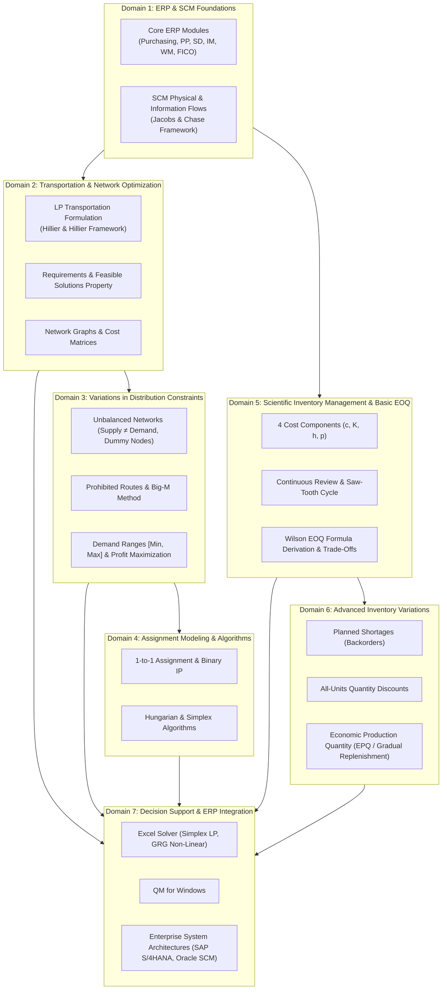
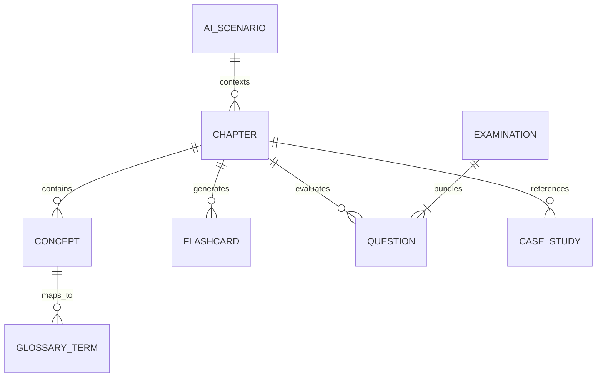

# KNOWLEDGE ARCHITECTURE & ONTOLOGY SPECIFICATION
## ERP Knowledge Hub — Enterprise Resource Planning & Supply Chain Management

---

## 1. Architectural Philosophy & Alignment

The **ERP Knowledge Hub** architecture directly reflects the foundational textbook: *Enterprise Resource Planning (ERP) Applied to Logistics & Supply Chain Management (UEH, 2020)*. Rather than imposing an arbitrary or generic syllabus, this ontology establishes an authentic knowledge graph that bridges:
1. **Academic Theory**: Mathematical programming, operations research, supply chain dynamics.
2. **Enterprise Execution**: Real-world ERP business modules (Procurement, Production, Sales & Distribution, Inventory Management, Transportation Management).
3. **Business Analyst Competencies**: Requirements engineering, process modeling, business rule formulation, decision modeling, acceptance criteria, and stakeholder alignment.

---

## 2. Core Learning Domains & Ontology Map

---

## 3. Curriculum Matrix: Weekly Chapters, Domains & Benchmark Cases

| Chapter ID | Official Coursebook Module | Primary Domain | Core Quantitative Focus | Primary Benchmark Case Studies |
|---|---|---|---|---|
| **CHAP-01** | Week 1: Introduction to ERP & Software Applications in Transportation | D1, D2, D7 | Linear Programming Transportation Model; Simplex LP; Network Flow Formulation | **P&T Company** (Pea distribution); **Texago Corp.** (Petroleum refining network & site selection) |
| **CHAP-02** | Week 2: Variations of Transportation Problems — Part 1 | D3, D7 | Supply-Demand Imbalances ($\sum s_i \neq \sum d_j$); Dummy sources/destinations; Prohibited route modeling | **Metro Water District** (Water allocation); **Energetic Company** (Energy systems); **Better Products Co.** (Case 2.1) |
| **CHAP-03** | Week 3: Variations of Transportation Problems — Part 2 & Assignment | D3, D4, D7 | Interval demand bounds $[L_j, U_j]$; Dual-criteria profit maximization; Zero-one assignment modeling | **Middletown School District** (Tract assignment); **Nifty Company** (Profit max); **Better Products Co.** (Case 2.2) |
| **CHAP-04** | Week 4: Software Applications in Inventory Management | D5, D7 | 4 Inventory cost components; Wilson square root derivation; GRG non-linear optimization | **Atlantic Coast Tire Corp. (ACT)** — Baseline Basic EOQ analysis |
| **CHAP-05** | Week 5: Variations of the EOQ Model in Inventory Management | D6, D7 | Backorder trade-offs; Price break curve evaluations; Finite production replenishment (EPQ) | **ACT Planned Shortages**; **ACT Quantity Discounts**; **SOCA** (Gradual replenishment) |
| **CHAP-06** | Week 6: Enterprise ERP/SCM Integration & Decision Synthesis | D1, D7 | Multi-echelon logistics network design; Cross-module ERP integration (MM, PP, SD, TM, EWM); Capstone BA review | **Comprehensive Integrated Case Synthesis** |

---

## 4. Entity Relationship Model & Data Architecture

The learning platform is powered by seven relational entity collections with normalized unique identifiers:

### Entity Specifications

1. **Chapter (`CHAP-xx`)**:
   - `id`: Unique identifier (e.g., `chap-01`, `chap-02`, etc.).
   - `week_number`: Academic week index (1 to 6).
   - `title`: Bilingual title (e.g., `vi`: "Tuần 1: Giới thiệu ERP...", `en`: "Week 1: Introduction to ERP...").
   - `overview`: Structured educational narrative (Overview, Objectives, Rationale, Inter-chapter linkages).
   - `sections`: 12 standardized pedagogical sections.

2. **Concept (`CONC-xxx`)**:
   - `id`: Stable key (e.g., `conc-eoq-basic`, `conc-tp-dummy`).
   - `chapter_id`: Foreign key to Chapter.
   - `name_vi` / `name_en`: Bilingual terminology.
   - `definition_vi` / `definition_en`: Formal definitions.
   - `mathematical_formulation`: LaTeX mathematical definitions and equations.
   - `ba_perspective`: Functional/non-functional requirements and business rules.

3. **Glossary Term (`GLOS-xxx`)**:
   - `id`: Unique term identifier.
   - `term_en`: Primary English industry terminology.
   - `term_vi`: Official Vietnamese academic translation.
   - `domain`: Classification category (e.g., `Transportation`, `Inventory`, `ERP Systems`, `Operations Research`).
   - `definition_en` / `definition_vi`: Concise dictionary definition.
   - `detailed_explanation_vi`: Comprehensive explanation.
   - `practical_example`: Realistic business application context.
   - `related_terms`: Array of linked glossary term IDs.

4. **Flashcard (`CARD-xxx`)**:
   - `id`: Card index.
   - `chapter_id`: Linked Chapter.
   - `front_en` / `front_vi`: Term, concept question, or formula prompt.
   - `back_en` / `back_vi`: Rigorous answer, formula breakdown, or operational rule.
   - `category`: `Definition`, `Formula`, `Business Rule`, `Model`, `Distinction`.

5. **Examination (`EXAM-xx`) & Question Bank (`QUES-xxx`)**:
   - Total Examinations: Exactly **10 structured examinations**.
   - Questions per Exam: Exactly **25 unique questions**.
   - Total Question Bank: Exactly **250 rigorous, non-duplicated questions**.
   - Examination Blueprint:
     - `EXAM-01`: ERP Fundamentals & SCM Information/Physical Flows (Chap 1)
     - `EXAM-02`: Linear Programming Transportation Foundations & P&T Case (Chap 1)
     - `EXAM-03`: Unbalanced Transportation Problems & Dummy Nodes (Chap 2)
     - `EXAM-04`: Transportation Constraints & Prohibited Routing (Chap 2)
     - `EXAM-05`: Demand Intervals, Profit Maximization & Assignment Models (Chap 3)
     - `EXAM-06`: Scientific Inventory Fundamentals & Cost Structures (Chap 4)
     - `EXAM-07`: Basic Economic Order Quantity (EOQ) & ACT Baseline (Chap 4)
     - `EXAM-08`: EOQ with Planned Shortages & Quantity Discounts (Chap 5)
     - `EXAM-09`: Economic Production Quantity (EPQ) & Gradual Replenishment (Chap 5)
     - `EXAM-10`: Comprehensive Enterprise SCM & Integrated BA Decision Modeling (Capstone)
   - Question Distribution: 40% Basic (10 Qs), 40% Intermediate (10 Qs), 20% Advanced (5 Qs).

6. **Case Study (`CASE-xx`)**:
   - `id`: `case-01`, `case-02`, `case-03`, `case-04`.
   - Complete unshortened English source text.
   - Complete faithful Vietnamese translation.
   - Detailed Business Analyst critique, operational workflows, and decision models.

7. **AI Consultant Scenarios (`AI-SCEN-xx`)**:
   - 8 specialized prompt engineering templates with pre-configured contextual grounding.

---

## 5. Bilingual Terminology Standardization Matrix

To guarantee strict linguistic consistency across the platform, the following authoritative technical terminology mappings are standardized:

| English Technical Term | Standard Vietnamese Translation | Synonyms / Common Usage in Vietnam | Contextual Notes |
|---|---|---|---|
| **Enterprise Resource Planning (ERP)** | Hệ thống hoạch định nguồn lực doanh nghiệp | Hệ thống ERP, quản trị tổng thể doanh nghiệp | Core enterprise backbone system |
| **Supply Chain Management (SCM)** | Quản trị chuỗi cung ứng | Quản lý chuỗi cung ứng | End-to-end material & information flows |
| **Transportation Problem** | Bài toán vận tải | Bài toán phân phối vận tải | Classical LP distribution model |
| **Feasible Solutions Property** | Tính chất nghiệm khả thi | Điều kiện khả thi của bài toán vận tải | $\sum \text{Supply} = \sum \text{Demand}$ |
| **Requirements Assumption** | Giả định về nhu cầu và cung ứng | Giả định nguồn và đích cố định | Strict equality of supply & demand nodes |
| **Dummy Destination / Source** | Điểm đến giả định / Nguồn giả định | Điểm giả định, đích hư cấu | Balances supply-demand inequalities |
| **Prohibited Route / Prohibited Combination** | Tuyến đường cấm / Tuyến vận chuyển không khả thi | Tuyến không thể sử dụng | Penalized via Big-M ($M$) coefficient |
| **Assignment Problem** | Bài toán phân công | Bài toán gán nhiệm vụ | 1-to-1 matching ($x_{ij} \in \{0, 1\}$) |
| **Hungarian Method** | Phương pháp Hungarian | Thuật toán Kuhn-Munkres | $O(n^3)$ combinatorial solver for assignment |
| **Economic Order Quantity (EOQ)** | Lượng đặt hàng kinh tế | Mô hình đặt hàng tối ưu EOQ | Minimizes holding + setup costs |
| **Economic Production Quantity (EPQ)** | Lượng sản xuất kinh tế | Mô hình bổ sung dần, quy mô lô sản xuất | Gradual replenishment with finite rate $p > d$ |
| **Setup Cost / Ordering Cost ($K$)** | Chi phí thiết lập / Chi phí đặt hàng | Chi phí mỗi lần đặt hàng | Incurred per batch regardless of size |
| **Holding Cost / Carrying Cost ($h$)** | Chi phí lưu kho / Chi phí tồn trữ | Chi phí giữ hàng tồn kho | Capital opportunity + storage + insurance |
| **Shortage Cost / Penalty Cost ($p$)** | Chi phí thiếu hụt | Chi phí hết hàng, phạt trễ đơn | Goodwill loss, delayed revenue |
| **Planned Shortages / Backorders** | Thiếu hàng có kế hoạch / Đơn hàng hoãn trả | Thiếu hụt cho phép, nợ hàng | Customers wait; fulfilled upon delivery |
| **Quantity Discount** | Chiết khấu theo số lượng | Giảm giá theo quy mô đơn hàng | All-units vs. incremental price breaks |
| **Reorder Point (ROP)** | Điểm đặt hàng lại | Mức tồn kho đặt hàng | Inventory level that triggers a replenishment order |
| **Lead Time** | Thời gian giao hàng / Thời gian thực hiện | Thời gian chờ bổ sung hàng | Transit & processing duration |
| **Continuous Review Policy** | Chính sách kiểm tra liên tục | Mô hình $(s, Q)$ hoặc $(s, S)$ | Real-time inventory tracking |
| **Periodic Review Policy** | Chính sách kiểm tra định kỳ | Mô hình $(R, S)$ | Review at discrete time intervals |
