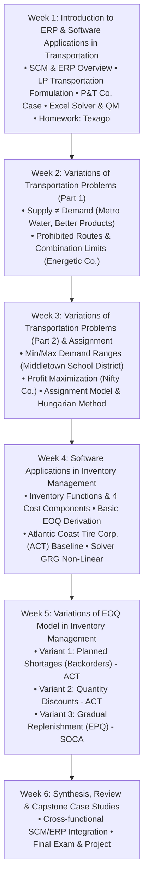

# TEXTBOOK CONTENT AUDIT & INVENTORY REPORT
## Coursebook: Enterprise Resource Planning (ERP) Applied to Logistics & Supply Chain Management

---

## 1. Bibliographic & Archival Metadata

- **Full Coursebook Title**: *ENTERPRISE RESOURCE PLANNING (ERP) APPLIED TO LOGISTICS & SUPPLY CHAIN MANAGEMENT (2 Credits)*
- **Publication Subtitle**: *This textbook is for internal circulation only | 2020*
- **Academic Institution**: University of Economics Ho Chi Minh City (UEH) — School of International Business and Marketing (Khoa Kinh doanh Quốc tế - Marketing)
- **Author / Course Coordinator**: Y Hoang
- **Creation Date in Metadata**: February 16, 2020 (16:10:17 UTC+7)
- **Source Physical File**: `references/ERP transportation  inventory Textbook for Students.pdf`
- **File Length**: 149 slides / pages
- **Format**: Presentation Slide Coursebook compiled for undergraduate/postgraduate logistics instruction.
- **Pedagogical Focus**: Linear Programming (LP) Transportation Models, Variations in Distribution & Supply Constraints, Scientific Inventory Management (EOQ, EPQ, Backorders, Quantity Discounts), and Decision Support Software (Microsoft Excel Solver & QM for Windows).

---

## 2. Table of Contents & Weekly Syllabus Architecture

As established on Slides 5, 6, and 7 of the coursebook, the syllabus is partitioned into six sequential instructional weeks:

---

## 3. Chapter-by-Chapter Detailed Content Audit

### 3.1 Course Introduction (Slides 1–8)
- **Slide 1–2**: Title slide, UEH School of International Business and Marketing branding, course credits (2 Credits).
- **Slide 3**: Learning Objectives:
  1. Understand the overview of ERP.
  2. Recognize common operational problems in SCM.
  3. Master theoretical supply chains and standard optimization problems.
  4. Formulate and solve transportation and inventory models using Excel Solver and QM for Windows.
- **Slide 4**: Grading Structure:
  - Attendance & In-class discussion: 20%
  - Groupwork & homework: 30%
  - Final assessment (group project + presentation): 50%
- **Slides 5–7**: Detailed weekly syllabus breakdown (Weeks 1 to 6).
- **Slide 8**: Divider slide.

---

### 3.2 Week 1: Introduction to ERP & Software Applications in Transportation (Slides 9–47)

#### A. Agenda & Core Themes (Slides 9–14)
- ERP Foundations: Cross-functional coordination across core business modules:
  - Purchasing / Procurement
  - Production Planning & Manufacturing
  - Sales & Distribution (SD)
  - Inventory Management
  - Warehouse Management (WMS)
  - Human Resource Management (HRM)
  - Financial Accounting & Controlling (FICO)
- SCM Conceptual Foundation: Reference to Jacobs & Chase (2013) — *“Supply chain refers to processes that move information and material to and from the manufacturing and service processes of the firm...”*
- Transportation Definition: Reference to Hillier & Hillier (2013) — Study of optimal allocation and physical distribution of constrained resources from origins to destinations.

#### B. Theoretical Transportation Model (Slides 15–35)
- **Key Assumptions**:
  - *Requirements Assumption*: Every source $i$ has a fixed available supply $s_i$. Every destination $j$ has a fixed required demand $d_j$. All supply must be distributed, and all demand must be met.
  - *Feasible Solutions Property*: A standard transportation problem possesses feasible solutions if and only if:
    $$\sum_{i=1}^m s_i = \sum_{j=1}^n d_j$$
  - *Cost Proportionality*: Cost of shipping from origin $i$ to destination $j$ is strictly proportional to units shipped ($c_{ij} \times x_{ij}$).
- **General Mathematical LP Formulation**:
  $$\text{Minimize } Z = \sum_{i=1}^m \sum_{j=1}^n c_{ij} x_{ij}$$
  Subject to:
  $$\sum_{j=1}^n x_{ij} = s_i \quad \forall i=1, \dots, m \quad \text{(Supply Constraints)}$$
  $$\sum_{i=1}^m x_{ij} = d_j \quad \forall j=1, \dots, n \quad \text{(Demand Constraints)}$$
  $$x_{ij} \ge 0 \quad \forall i, j$$

#### C. Core Benchmark Case: P&T Company (Slides 25–46)
- **Company Profile**: Small family-owned canned vegetables cannery business (canned peas).
- **Network Layout**:
  - 3 Canneries (Origins): Bellingham (75 truckloads), Eugene (125 truckloads), Albert Lea (100 truckloads). Total Supply = 300 truckloads.
  - 4 Warehouses (Destinations): Sacramento (80 truckloads), Salt Lake City (65 truckloads), Rapid City (70 truckloads), Albuquerque (85 truckloads). Total Demand = 300 truckloads.
- **Freight Cost Table ($/truckload)**:
  | Cannery \ Warehouse | Sacramento | Salt Lake City | Rapid City | Albuquerque | Cannery Output |
  |---|---|---|---|---|---|
  | **Bellingham** | $464 | $513 | $654 | $867 | 75 |
  | **Eugene** | $352 | $416 | $690 | $791 | 125 |
  | **Albert Lea** | $995 | $682 | $388 | $685 | 100 |
  | **Required Demand** | 80 | 65 | 70 | 85 | **300** |
- **Current Heuristic Approach Cost**: \$179,850.
- **Optimal LP Solution via Solver / QM**:
  - Bellingham to Sacramento: 0; Bellingham to Salt Lake City: 0; Bellingham to Rapid City: 0; Bellingham to Albuquerque: 75.
  - Eugene to Sacramento: 80; Eugene to Salt Lake City: 45; Eugene to Rapid City: 0; Eugene to Albuquerque: 0.
  - Albert Lea to Sacramento: 0; Albert Lea to Salt Lake City: 20; Albert Lea to Rapid City: 70; Albert Lea to Albuquerque: 10.
  - Optimal Cost: **\$152,535** (Savings of \$27,315 / 15.2% reduction!).
- **Software Implementation**: Detailed screenshots for Excel Solver (Simplex LP engine) and QM for Windows (Slides 39–45).
- **Homework Assignment**: The Texago Corp. Site Selection Problem (Case 1).

---

### 3.3 Week 2: Variations of Transportation Problems — Part 1 (Slides 48–58)

#### A. Variant 1: Supply $\neq$ Demand (Slides 51–54)
- **Condition 1: Total Supply > Total Demand ($\sum s_i > \sum d_j$)**
  - **Case: Metro Water District**:
    - Sources: Colombo River (5), Sacron River (6), Calorie River (5). Total Available Supply = 16 million acre-feet.
    - Destinations: Berdoo (2), Los Devils (5), San Go (4), Hollyglass (1.5). Total Needed Demand = 12.5 million acre-feet.
    - Excess Supply = $16 - 12.5 = 3.5$ million acre-feet.
    - **Formulation Technique**: Introduce a **Dummy Destination** with demand of 3.5 million acre-feet and shipping cost $c_{i, \text{Dummy}} = 0$ for all sources. Water allocated to dummy represents unutilized river capacity.
    - **Prohibited Route Constraint**: Calorie River cannot supply Hollyglass (represented with prohibitively large unit cost $M$ or variable omitted).

- **Condition 2: Total Demand > Total Supply ($\sum d_j > \sum s_i$) / Assigning Plants to Products**
  - Analyzed via **Better Products Company** (Case 2.1).
  - Production capacity is limited; unmet customer demand is represented by a **Dummy Source** with cost equal to lost profit or zero depending on objective formulation.

#### B. Variant 2: Prohibited Routes and Combination Limitations (Slides 55–57)
- **Case: Energetic Company**:
  - Facility requires energy for: (1) Electricity = 20 units, (2) Water Heating = 10 units, (3) Space Heating = 30 units.
  - Available sources: Electricity (unlimited), Natural Gas (unlimited), Rooftop Solar Heater (capacity $\le 30$ units).
  - Operational Rule: Electricity category can ONLY be satisfied by electrical power (solar and gas cannot produce electricity in this setup: $c_{\text{Gas},\text{Elec}} = M$, $c_{\text{Solar},\text{Elec}} = M$).
  - Cost matrix and capacity ceilings are integrated into the transportation tableau.

---

### 3.4 Week 3: Variations of Transportation Problems — Part 2 & Assignment Problems (Slides 59–70)

#### A. Variant 3: Unstable Demand between Minimum and Maximum Range (Slides 62–64)
- **Case: Middletown School District**:
  - City redistricting into 9 residential tracts with 4,100 high school students.
  - 3 High Schools with capacity bounds:
    - School 1: Min enrollment 1,200; Max enrollment 1,800.
    - School 2: Min enrollment 1,100; Max enrollment 1,700.
    - School 3: Min enrollment 1,000; Max enrollment 1,500.
  - Sum of minimum capacities = 3,300 $\le 4,100 \le$ Sum of maximum capacities = 5,000.
  - Objective: Minimize total student-miles traveled ($\sum \sum d_{ij} x_{ij}$).
  - LP Formulation: Dual constraint bounds for each school destination ($L_j \le \sum_{i} x_{ij} \le U_j$).

#### B. Variant 4: Profit Maximization Objective (Slides 65–66)
- **Case: Nifty Company**:
  - 3 Production Plants: Plant 1 (8,000), Plant 2 (5,000), Plant 3 (7,000). Total Supply = 20,000 units.
  - 4 Customers with minimum commitment and requested order ceilings:
    - Customer 1: Min 7,000; Max 7,000.
    - Customer 2: Min 3,000; Max 9,000.
    - Customer 3: Min 2,000; Max 6,000.
    - Customer 4: Min 0; Max 8,000.
  - Unit profit matrix: Maximizing Total Profit $Z = \sum \sum P_{ij} x_{ij}$.
  - Conversion rule: Solver objective set to `Max`, or transformed to minimization by subtracting profits from maximum profit value ($C_{ij} = P_{\max} - P_{ij}$).

#### C. Assignment Problem & Algorithmic Foundations (Slides 67–70)
- Characteristics: $n$ assignees mapped to $n$ tasks on a 1-to-1 basis ($x_{ij} \in \{0, 1\}$).
- Case 2.2: Better Products Co. with product splitting prohibited.
- Special Algorithms:
  - **Transportation Simplex Method**: Special streamlined simplex algorithm using basis trees and stepping-stone loops.
  - **Network Simplex Method**: Ultra-fast graph algorithm for generalized network flows.
  - **Hungarian Method (Kuhn-Munkres Algorithm)**: $O(n^3)$ combinatorial optimization algorithm for the assignment problem based on reduced cost matrices.
- Transportation Glossary terms (Slides 68–70).

---

### 3.5 Week 4: Software Applications in Inventory Management (Basic EOQ) (Slides 71–97)

#### A. Foundations of Scientific Inventory Management (Slides 73–76)
- Definition: Monitoring stock levels, determining order replenishment policies, minimizing total enterprise costs.
- Scientific Inventory Steps:
  1. Formulate a mathematical model describing the inventory system behavior.
  2. Derive an optimal inventory policy through analytical or numerical optimization.
  3. Deploy an information processing system (ERP module) to track transactions and execute order policies.

#### B. The 4 Cost Components of Inventory Models (Slides 77–79)
1. **Acquisition Cost ($c$)**: Direct cost per purchased or manufactured unit.
   $$\text{Annual Acquisition Cost} = c \times D$$
2. **Setup / Ordering Cost ($K$)**: Fixed administrative, ordering, transportation, receiving, and inspection cost incurred per order batch, independent of batch size.
   $$\text{Annual Setup Cost} = K \times \frac{D}{Q}$$
3. **Holding / Carrying Cost ($h$)**: Cost of holding 1 unit of stock for 1 year.
   - Capital opportunity cost (foregone return on tied-up capital).
   - Storage space leasing and warehouse operations.
   - Insurance, shrinkage, obsolescence, damage, and inventory property taxes.
   - Typically represented as $h = I \times c$, where $I$ is the annual carrying rate percentage.
   $$\text{Annual Holding Cost} = h \times \frac{Q}{2}$$
4. **Shortage / Stockout Cost ($p$)**: Cost incurred when demand exceeds available inventory (loss of customer goodwill, late penalties, expedited freight, lost sales).

#### C. The Basic Economic Order Quantity (EOQ) Model (Slides 80–88)
- **Key Assumptions**:
  1. Continuous, known, constant demand rate $D$.
  2. Replenishment lot $Q$ arrives all at once (instantaneous delivery).
  3. No shortages are permitted ($p \to \infty$).
  4. Constant parameters $c, K, h$ over planning horizon.
- **Total Variable Cost Function (TVC)**:
  $$TVC(Q) = \text{Annual Setup Cost} + \text{Annual Holding Cost} = K\frac{D}{Q} + h\frac{Q}{2}$$
- **Derivation of Wilson's Formula**:
  $$\frac{d(TVC)}{dQ} = -\frac{KD}{Q^2} + \frac{h}{2} = 0 \implies \frac{KD}{Q^2} = \frac{h}{2} \implies Q^* = \sqrt{\frac{2KD}{h}}$$
- **Key Performance Indicators**:
  - Annual Order Frequency: $N^* = \frac{D}{Q^*}$
  - Cycle Length: $T^* = \frac{Q^*}{D}$ years
  - Total Variable Cost at Optimum:
    $$TVC^* = \sqrt{2KDh}$$
  - Note: At $Q^*$, Annual Setup Cost exactly equals Annual Holding Cost ($K\frac{D}{Q^*} = h\frac{Q^*}{2}$).

#### D. Application to Atlantic Coast Tire Corp. (ACT) (Slides 89–96)
- Case Data: Tire 185/70 R13, $D = 6,000$ tires/year, $c = \$20$, $K = \$115$, $h = 21\% \times \$20 = \$4.20$/tire/year.
- Current Policy ($Q = 1,000$):
  - Setup Cost = $115 \times \frac{6000}{1000} = \$690$
  - Holding Cost = $4.20 \times \frac{1000}{2} = \$2,100$
  - Current $TVC = 690 + 2100 = \mathbf{\$2,790}$
- Optimal Policy ($Q^*$):
  $$Q^* = \sqrt{\frac{2 \times 115 \times 6000}{4.20}} = \sqrt{328,571.43} \approx 573.2 \implies \mathbf{573 \text{ tires}}$$
  - Optimal Setup Cost = $115 \times \frac{6000}{573.2} \approx \$1,203.74$
  - Optimal Holding Cost = $4.20 \times \frac{573.2}{2} \approx \$1,203.74$
  - Optimal $TVC^* = 1,203.74 + 1,203.74 = \mathbf{\$2,407.48}$
  - **Net Annual Savings**: $\$2,790 - \$2,407.48 = \mathbf{\$382.52}$ (13.7% reduction).
- Solver Workflow: Demonstrates formulation in Excel using the **GRG Non-Linear** solving engine (Slide 93).

---

### 3.6 Week 5: Variations of EOQ Model in Inventory Management (Slides 98–142)

#### A. Variant 1: The EOQ Model with Planned Shortages (Backorders) (Slides 102–116)
- **Concept**: Shortages are allowed and fully backordered. Customers wait for incoming shipments.
- **Decision Variables**: Order quantity $Q$, Maximum backorder level $S$.
- **Inventory Metrics**:
  - Maximum Inventory Level = $Q - S$
  - Fraction of cycle with positive inventory = $\frac{Q - S}{Q}$
  - Average inventory when positive = $\frac{Q - S}{2}$
  - Fraction of cycle in shortage = $\frac{S}{Q}$
  - Average shortage when short = $\frac{S}{2}$
- **Cost Function**:
  $$TVC(Q, S) = K\frac{D}{Q} + h\frac{(Q-S)^2}{2Q} + p\frac{S^2}{2Q}$$
- **Optimal Analytical Formulas**:
  $$Q^* = \sqrt{\frac{2KD}{h}} \sqrt{\frac{p + h}{p}}$$
  $$S^* = \left(\frac{h}{p + h}\right) Q^*$$
  $$\text{Max Inventory } (Q^* - S^*) = \sqrt{\frac{2KD}{h}} \sqrt{\frac{p}{p + h}}$$
  $$TVC^* = \sqrt{2KDh} \sqrt{\frac{p}{p + h}}$$
- **Application to ACT** ($p = \$7.50$/unit/year):
  - $\sqrt{\frac{p+h}{p}} = \sqrt{\frac{7.50 + 4.20}{7.50}} = \sqrt{1.56} \approx 1.249$
  - $Q^* = 573.2 \times 1.249 \approx \mathbf{716 \text{ tires}}$
  - $S^* = \frac{4.20}{11.70} \times 716 \approx \mathbf{257 \text{ tires}}$
  - Maximum Inventory = $716 - 257 = \mathbf{459 \text{ tires}}$
  - $TVC^* = \$2,407.48 \times \sqrt{\frac{7.50}{11.70}} \approx \mathbf{\$1,927.56}$
  - **Annual Savings vs. Basic EOQ**: $\$2,407.48 - \$1,927.56 = \mathbf{\$479.92}$ (19.9% further savings!).

#### B. Variant 2: The EOQ Model with Quantity Discounts (Slides 117–127)
- **Concept**: Unit price $c(Q)$ and holding cost $h(Q) = I \times c(Q)$ decrease with larger lot sizes. Total annual cost must include purchase acquisition costs:
  $$TC(Q) = c(Q) \cdot D + K\frac{D}{Q} + h(Q)\frac{Q}{2}$$
- **ACT Discount Schedule**:
  | Tier $k$ | Order Range $Q$ | Unit Price $c_k$ | Holding Cost $h_k = 0.21 c_k$ | Unconstrained $Q_k^*$ | Feasible Order Quantity | Total Annual Cost $TC$ |
  |---|---|---|---|---|---|---|
  | 1 | 0 – 749 | \$20.00 | \$4.200 | 573.2 | 573.2 | \$122,407.48 |
  | 2 | 750 – 1,999 | \$19.80 (1% off) | \$4.158 | 576.1 | **750.0 (Breakpoint)** | **\$121,279.25** |
  | 3 | $\ge 2,000$ | \$19.60 (2% off) | \$4.116 | 579.0 | 2,000.0 (Breakpoint) | \$122,061.00 |
- **Optimal Decision**: Order $Q = 750$ tires at Tier 2 breakpoint, yielding minimum annual total cost of **\$121,279.25** (Saving \$1,128.23/year compared to basic EOQ without discount).

#### C. Variant 3: The EOQ Model with Gradual Replenishment (EPQ) (Slides 128–142)
- **Concept**: Items are produced in-house at finite production rate $p > d$. Replenishment occurs gradually over production time $t_p = Q/p$.
- **Inventory Mechanics**:
  - Net accumulation rate during production: $p - d$
  - Maximum inventory: $M = t_p (p - d) = \frac{Q}{p} (p - d) = Q \left(1 - \frac{d}{p}\right)$
  - Average inventory: $\frac{M}{2} = \frac{Q}{2} \left(1 - \frac{d}{p}\right)$
- **Total Variable Cost Function**:
  $$TVC(Q) = K\frac{D}{Q} + h\frac{Q}{2}\left(1 - \frac{d}{p}\right)$$
- **Optimal Production Batch Size (EPQ Formula)**:
  $$Q^* = \sqrt{\frac{2KD}{h\left(1 - \frac{d}{p}\right)}}$$
- **Application to SOCA Case Study**:
  - Television speaker assembly: $d = 1,000$ units/day, $p = 3,000$ units/day.
  - $D = 1,000 \times 250 = 250,000$ units/year.
  - $c = \$12$, $K = \$12,000$, $h = \$3.60$/unit/year.
  - Production factor: $1 - d/p = 1 - 1/3 = 2/3 \approx 0.6667$.
  - Current Policy ($Q = 30,000$): Setup Cost = \$100,000, Holding Cost = \$36,000, Current $TVC = \mathbf{\$136,000}$.
  - Optimal Policy:
    $$Q^* = \sqrt{\frac{2 \times 12,000 \times 250,000}{3.60 \times (2/3)}} = \sqrt{\frac{6,000,000,000}{2.40}} = \sqrt{2,500,000,000} = \mathbf{50,000 \text{ speakers}}$$
  - Optimal Setup Cost = $12,000 \times \frac{250,000}{50,000} = \$60,000$
  - Max Inventory = $50,000 \times \frac{2}{3} = 33,333.33$ units; Average Inventory = $16,666.67$ units.
  - Optimal Holding Cost = $3.60 \times 16,666.67 = \$60,000$
  - Optimal $TVC^* = \$60,000 + \$60,000 = \mathbf{\$120,000}$
  - **Net Annual Savings**: $\$136,000 - \$120,000 = \mathbf{\$16,000}$ per year.

---

### 3.7 Glossaries & Wrap-up (Slides 143–149)
- **Transportation Glossary (Slides 68–70)**: Assignees, Cost table, Demand, Destinations, Hungarian method, Network simplex method, Sources, Supply, Tasks, Transportation simplex method.
- **Inventory Glossary (Slides 143–148)**: Acquisition cost, Holding cost, Setup cost, Shortage cost, Reorder point, Lead time, Inventory system, Manufacturing inventory, Service level, Safety stock, Continuous review policy, Periodic review policy, Economic Order Quantity.
- **Slide 149**: Week 6 Final Presentation wrap-up.

---

## 4. Extraction Limitations & Visual Audit Observations

1. **Slide-based Formatting**: The textbook is structured as PowerPoint lecture slides rather than narrative prose. Consequently, explanatory depth must be expanded in the Knowledge Base through formal Business Analyst perspectives and ERP architectural workflows without deviating from core mathematical parameters.
2. **Missing Demand Data in Slide 3 (Case 1)**: As identified during the cross-audit, Table 2.8.2 in the Case 1 PDF omitted distribution center demand requirements. This omission is completely rectified by the high-resolution reference artifact `Bổ sung dữ liệu cho case study 1 - TEXAGO.jpg`.
3. **Software Screen Captures**: Several slides (Slides 41–45, 93–96, 113–115, 124–125, 137–141) contain UI screenshots of Microsoft Excel 2016/365 Solver parameter dialogs and QM for Windows version 5. These workflow steps have been fully transcribed and converted into step-by-step procedural guides for both platforms.
